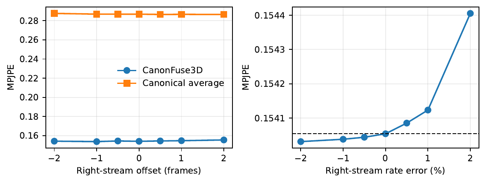
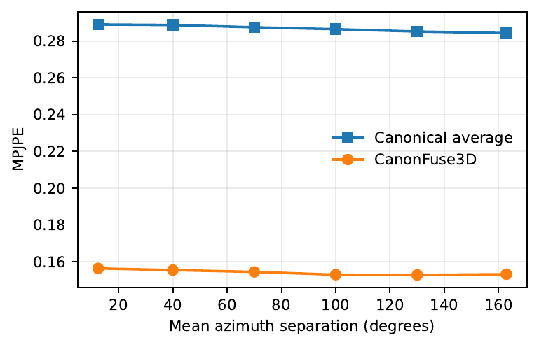
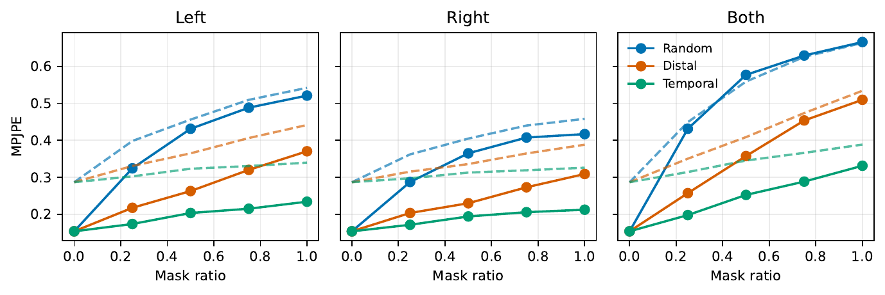
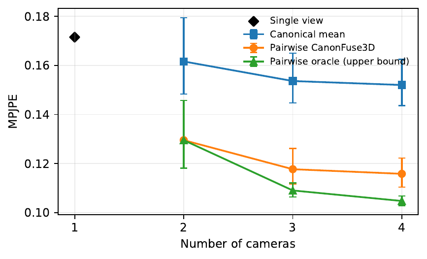
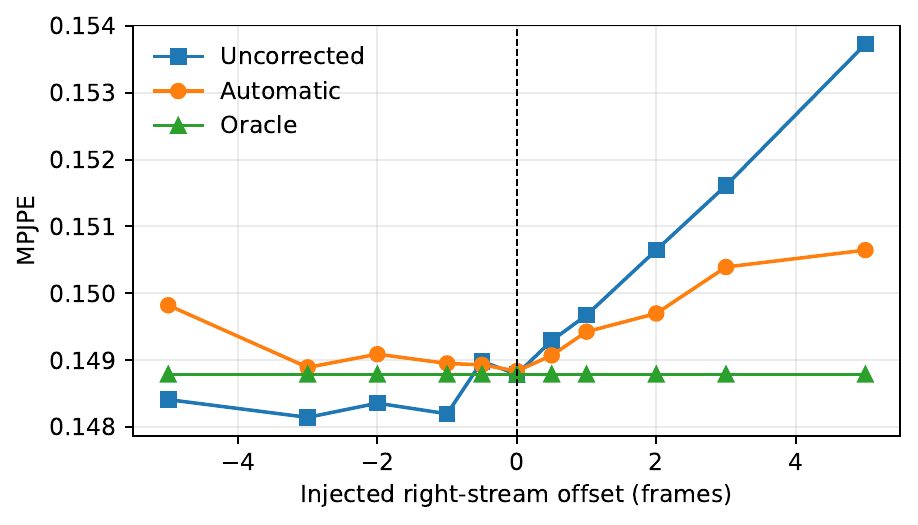
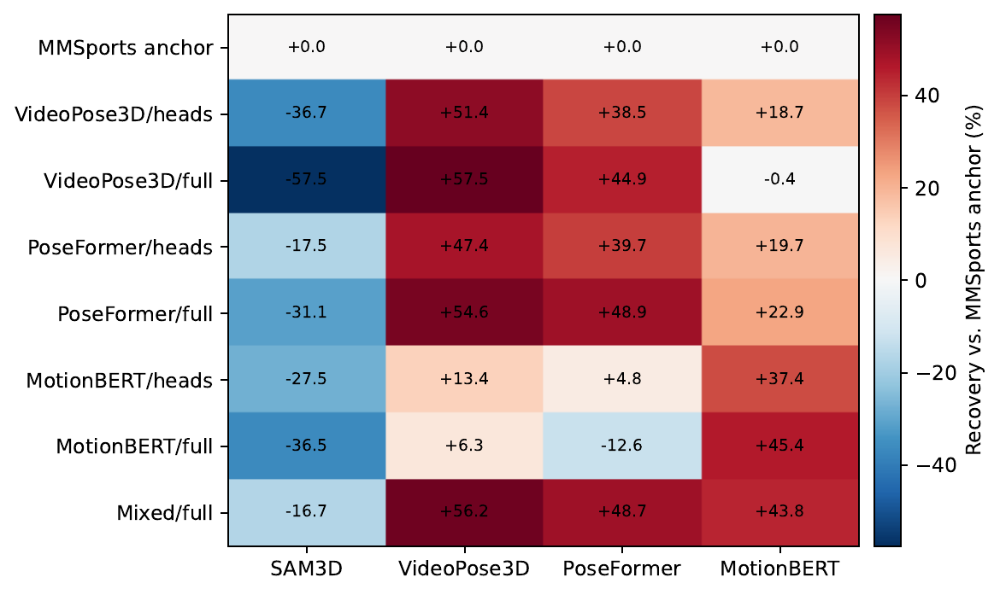

# 報告概要

本報告は、MMSports conference 論文を基礎として、CanonFuse3D の IVC ジャーナル稿に追加した実験を整理したものである。MMSports 論文の科学的な中心は変更していない。CanonFuse3D は、カメラの内部・外部パラメータ、画像、または2次元キーポイントを融合ネットワークへ入力せず、二つの単眼3次元姿勢系列を身体中心座標へ正規化し、系列単位の相似変換による位置合わせ、双方向クロスビュー注意、短時間の時系列モデリング、信頼度ゲートによる融合、および残差補正を行う。

ジャーナル拡張の目的は、手法を再定義することではなく、conference 原稿で十分に検証できていなかった実運用上の問いに答えることである。具体的には、上流3次元姿勢推定器を変更した場合の汎化、小さな同期誤差に対する安定性、カメラ間角度の影響、欠損や破損が生じた際の限界、双視点モデルの N-view への拡張可能性、さらに前段分布が変化した場合に適応学習で性能を回復できるかを検証した。

現時点で **8項目の拡張実験**が完了している。内訳は、Unity 参照チェックポイントを固定した6項目の評価、時間位置合わせを前処理として追加した診断実験、ならびに前段適応学習である。前段適応以外では CanonFuse3D の重みを更新していない。さらに、ジャーナルの実データ定量基準を確立するため、固定 Ski-PTZ-Pose テストインデックスで独立再評価を完了した。この再評価は基準監査であり、8項目の拡張実験には数えない。自動時間位置合わせは方向非対称性と誤作動を示したため、主結論を強化する成功例ではなく診断結果として扱う。

最も重要な総合結論は次のとおりである。

> **CanonFuse3D は、学習時の前段分布に近い条件では高い頑健性を示す、カメラキャリブレーション不要の姿勢空間リファインメント手法である。一方、上流推定器に依存しない汎用融合器ではない。**

ネイティブの SAM3D 入力では、Unity の完全なホールドアウトテスト集合において common-13 MPJPE を 0.2792 から 0.1551 へ低減し、44.5% の改善を得た。固定30エントリの Ski-PTZ-Pose common-13 テストインデックスでは、融合参照 MPJPE を 0.3487 から 0.1794 へ低減し、48.6% 改善した。2フレーム以内の時間ずれ、および2%以内のサンプリングレート誤差による MPJPE の変化は1%未満であった。カメラ方位角差の全区間で約46%の改善を維持し、片側または構造化された欠損では補完視点を有効に利用できた。一方、固定モデルを PoseFormer と VideoPose3D に直接適用すると負の転移が生じ、両視点が高密度かつ独立にランダム破損した場合には、学習型融合がカノニカル平均を上回らなかった。前段適応により分布ずれは大幅に緩和できるが、ネイティブ前段の保持性能とのトレードオフが生じる。

## 1ページ要約

| ID | 拡張実験 | 状態 | 主要結果 | 論文上の役割 |
|---|---|---:|---|---|
| J0 | ジャーナル定量基準監査 | 完了 | Unity common-13：0.2792→0.1551；Ski-PTZ common-13：0.3487→0.1794 | 現行の追跡可能な結果で旧conference数表を置換 |
| E1 | 前段汎化比較 | 完了 | SAM3D +44.5%、MotionBERT +8.0%；PoseFormer -18.0%、VideoPose3D -12.8% | 前段非依存ではないことを定量化 |
| E2 | 時間オフセット頑健性 | 完了 | ±2フレーム以内の最大変化は +0.91% | 小さな同期誤差への安定性を支持 |
| E3 | サンプリングレート不一致 | 完了 | ±2%以内の最大変化は +0.23% | 小さなクロックずれへの許容性を支持 |
| E4 | カメラ間角度分析 | 完了 | 六区間での融合改善率は 45.9%–46.6% | テスト範囲内で明確な角度破綻がない |
| E5 | 遮蔽・欠損頑健性 | 完了 | 片側・末端・時間区間欠損では優位；両側ランダム破損では -3.3% | 明確な破綻条件を提示 |
| E6 | N-view 拡張 | 完了 | 1/2/3/4視点 MPJPE は 0.1715/0.1295/0.1177/0.1158、2/3/4視点の直列遅延は 2.02/6.02/12.06 ms | 双視点で主要な精度利益を得られ、視点追加では利益が逓減し pair コストが増加 |
| E7 | 自動時間位置合わせ | 完了、診断用 | +5フレームで 0.1537→0.1506；負の整数オフセットは全て悪化 | 現状は信頼できる双方向同期器ではない |
| E8 | 前段適応学習 | 完了 | 三つの対象前段で 57.5%、48.9%、45.4% 回復 | 負の転移は緩和可能だが保持性能に代償 |

# 1. 報告範囲とジャーナル定量基準

## 1.1 MMSports 初版との関係

MMSports 論文は CanonFuse3D の採択済み初版であり、モデル構造、最初の二データセット比較、特徴アブレーション、初期 masking 分析、定性的事例を提示した。IVC 稿ではモデル構造を変更せず、完全テスト集合監査、前段転移と適応、時間・カメラ条件の摂動、系統的な欠損入力、N-view ペア構成、および自動同期診断を追加した。

異なる由来の数値を混在させないため、現行 IVC 本文と本報告では、初版の数値表および特徴アブレーション数表を再掲しない。conference 論文自体は引用し、再利用関係を開示するが、現在の定量結論はすべてジャーナル証拠ディレクトリの評価記録に基づく。初版由来の定性的事例には引き続き出典を明記する。

## 1.2 現行ジャーナル定量基準

| データセット／関節集合 | カノニカル平均 | CanonFuse3D | 相対改善 | 参照とプロトコル |
|---|---:|---:|---:|---|
| Unity / common-13 | 0.2792 | **0.1551** | 44.5% | 完全な64,440カメラペアのホールドアウト集合；avatar 3D骨格 |
| Unity / all-15 | 0.2868 | **0.1541** | 46.3% | 同一の完全テスト集合；制御摂動実験に使用 |
| Ski-PTZ-Pose / common-13 | 0.3487 | **0.1794** | 48.6% | 固定30エントリのテストインデックス；融合カノニカル参照 |

Ski-PTZ-Pose の acceleration error も、カノニカル平均の0.0392から0.0311へ低下した。この値は融合カノニカル参照との一致度であり、独立したモーションキャプチャ真値に対する物理的3D精度ではない。独立再実行の四桁丸め値は初版記録と一致したが、本報告はconference表のコピーではなく、新たに生成した固定インデックス結果ファイルを使用する。

Ski-PTZ-Pose 結果の出所管理は次のとおりである。

- データセット専用チェックポイント：last.ckpt、epoch 97、SHA-256 2b985d4f8b5e1f083fa549ae1cfa524c7d48a8fa2452fbcb136f2f514d1ed78d。
- 固定インデックス SHA-256：967a17ad2edfa8f56801d9a7cdd9c683dc73d0072660298ff65294445b41ba02。
- テストプロトコル：30 camera-pair エントリ、各30フレーム、common-13、batch size 4、drop_last=False、seed 42。
- インデックスは150 train、0 validation、30 testを含む。履歴上の学習経路は epoch 監視にtrain一覧を再利用しているため、その監視値は独立validation証拠ではない。テスト結果を見た後のモデル選択を避けるため、epoch-97 last.ckptを事前に固定し、完全test結果のみを報告する。
- インデックス内の履歴絶対ルートはメモリ上でのみ書き換え、元のJSONは変更していない。

## 1.3 今回の範囲に含めない内容

現在の論文および本報告では、複数乱数シードまたは多分割交差検証の結果を用いない。Unity 拡張は固定 action-disjoint 分割と seed 42 を用い、完全テスト集合、チェックポイントと前段重みのハッシュ、サンプル数、テスト時適応なしという監査項目で再現性を補強する。Ski-PTZ-Pose は上記の固定インデックスと独立チェックポイントを使用する。複数シード／多分割を未完了実験としても記載しない。

# 2. 拡張実験の共通設定

## 2.1 データセットと分割

拡張実験は主に Unity synthetic データセットで実施した。Unity データは二体の avatar から構成され、各 avatar が12の動作クリップを実行する。合計24の avatar-action 系列には、安定した滑走、周期動作、転倒、動作状態の遷移が含まれる。各動作は180の同期視点からレンダリングした。カメラは5層の高さに配置され、各層に10°間隔で36方位を持つ。

動作単位で非重複となる分割は次のとおりである。

| 分割 | avatar-action 数 | カメラペアサンプル数 | 用途 |
|---|---:|---:|---|
| Train | 12 | 193,320 | 元モデルまたは前段適応の学習 |
| Validation | 8 | 128,880 | チェックポイント選択と時間位置合わせ閾値の調整 |
| Test | 4 | **64,440** | 全拡張結果の最終評価 |

各インデックスサンプルでは、共通フレームを30フレーム系列へ一様再サンプリングする。これらはスライディングウィンドウではない。最終テスト batch も保持し、`drop_last` によるサンプル除外は行わない。

## 2.2 Ski-PTZ-Pose 定量プロトコル

Ski-PTZ-Pose はデータセット専用モデルによる実データ定量評価にのみ使用し、Unity の摂動、前段適応、N-view 実験には用いない。22関節アノテーションとフィルタ後の SAM3D 出力を共通13関節へ写像し、同期した二視点のアノテーションを個別にカノニカル化して平均し、学習監督と指標計算専用の融合参照を構成する。モデルは PTZ カメラパラメータを入力しない。この参照は独立物理3D真値ではないため、常に「融合参照との一致度」と表記する。

## 2.3 固定モデルと再現性

- Unity ジャーナル参照チェックポイント SHA-256：`869a2217f8676c0ada75ed3c9a3c82a9b8efbb105749f6ffb8bef71e9172f50f`。
- チェックポイントは epoch 89。hidden dimension 128、attention head 4、dropout 0.1、時間畳み込み kernel 5。
- 元学習は AdamW、learning rate 1e-3、weight decay 0.01、batch size 4096、100 epoch cosine schedule。
- 摂動乱数は seed 42。
- 時間、サンプリングレート、角度、masking 実験は CanonFuse3D の全15関節を使用。
- 前段比較と適応は4種類の前段に共通する13関節、すなわち出力 index 2–14を使用。

## 2.4 指標の解釈

主要指標は MPJPE であり、全フレーム・全関節について、予測3次元点と参照3次元点の平均ユークリッド距離を求める。値が小さいほど良い。Acceleration error は予測系列と参照系列の二階時間差分を比較し、運動の時間的安定性を測る。拡張実験の値はすべて正規化されたデータセット座標であり、ミリメートルへ読み替えることはできない。Gate preference accuracy は、実誤差の小さい視点へゲートが大きな重みを与えた割合である。これは信頼度の診断値であり、校正済み確率や不確実性ではない。

## 2.5 実験の区分

- **固定チェックポイント実験（E1–E6）**：コアモデルのパラメータを変更せず、外挿範囲と頑健性を測定する。
- **前置診断モジュール（E7）**：固定モデルの前に時間位置合わせを追加するが、CanonFuse3D の重みは変更しない。
- **適応学習（E8）**：train/validation データのみで新しいチェックポイントを学習し、固定 test split で評価する。

# 3. E1：異なる3次元姿勢前段への汎化

## 3.1 研究課題

Unity 参照モデルは SAM3D が生成した3次元姿勢系列を用いて学習した。上流3次元姿勢推定器を置き換えた場合、身体中心正規化だけで前段間の分布差を除去し、同じ融合チェックポイントを直接再利用できるかを検証する。

## 3.2 実験設計

ネイティブ SAM3D、VideoPose3D、PoseFormer、MotionBERT の4種類を比較した。後者3手法には同一の Unity ground-truth H36M-17 2次元軌跡を入力し、2D-to-3D lifting 部分だけを分離して比較した。したがって2次元検出器のノイズは含まれない。各前段出力を common-13 骨格へ統一し、同一の固定 CanonFuse3D チェックポイントを全64,440テストカメラペアへ適用した。

## 3.3 結果

| 前段 | カノニカル平均 MPJPE | 融合 MPJPE | 相対改善 | Gate preference |
|---|---:|---:|---:|---:|
| SAM3D（ネイティブ） | 0.2792 | **0.1551** | **+44.5%** | 91.7% |
| MotionBERT | 0.4766 | **0.4385** | +8.0% | 61.4% |
| PoseFormer | **0.4542** | 0.5360 | **-18.0%** | 52.3% |
| VideoPose3D | **0.4776** | 0.5389 | **-12.8%** | 47.0% |

## 3.4 解釈

ネイティブ SAM3D における44.5%の改善と91.7%の gate preference は、ゲートが学習分布に対応する局所的な信頼度パターンを捉えていることを示す。MotionBERT では8.0%の正の改善を維持したが、改善幅は大きく縮小した。PoseFormer と VideoPose3D では負の転移が生じ、融合結果は各前段のカノニカル平均よりそれぞれ18.0%、12.8%悪化した。両者の gate preference も、二者からランダムに選ぶ水準に近い、またはそれを下回る。

身体中心正規化は全体の平行移動、回転、スケール差を抑えるが、推定器固有の四肢バイアス、時間統計、奥行き誤差、骨格マッピング残差までは除去できない。したがって現チェックポイントを estimator-agnostic と呼ぶことはできない。

> **報告上の結論：** 固定 CanonFuse3D は MotionBERT に対して限定的なゼロショット転移を示すが、PoseFormer と VideoPose3D には信頼して直接適用できない。前段を変更する場合は再検証し、必要に応じて適応学習を行う必要がある。

## 3.5 限界

本実験では実際の3次元 lifting モデルを使用したが、2次元入力は Unity ground-truth tracks であり、変数分離を目的としている。画像検出誤差、遮蔽による2次元キーポイント欠損、検出器間の信頼度差は対象外である。したがって結果が支持するのは lifting 前段の転移であり、RGB-to-3D パイプライン全体の end-to-end 汎化ではない。

# 4. E2：時間オフセットに対する頑健性

## 4.1 研究課題

双視点モデルは入力同期を前提とするが、実際のカメラでは1フレーム未満から数フレームのトリガ誤差が生じ得る。小さな時間ずれによって固定モデルが直ちに破綻するかを検証した。

## 4.2 実験設計

左視点を固定し、右視点へ -2、-1、-0.5、0、+0.5、+1、+2フレームのオフセットを注入した。半フレーム条件は線形補間で生成し、境界では複製パディングを用いた。各条件で全64,440テストサンプル、全15関節を評価した。

## 4.3 結果

| 右系列オフセット | カノニカル平均 | 融合 MPJPE | 0フレーム比変化 | Gate corr. | Gate preference |
|---:|---:|---:|---:|---:|---:|
| -2フレーム | 0.2876 | 0.1542 | +0.08% | 0.646 | 91.5% |
| -1フレーム | 0.2869 | **0.1537** | -0.21% | 0.649 | 91.6% |
| -0.5フレーム | 0.2868 | 0.1544 | +0.22% | 0.648 | 91.6% |
| 0フレーム | 0.2868 | 0.1541 | 0.00% | 0.650 | 91.7% |
| +0.5フレーム | 0.2865 | 0.1544 | +0.24% | 0.650 | 91.7% |
| +1フレーム | 0.2866 | 0.1547 | +0.41% | 0.650 | 91.8% |
| +2フレーム | 0.2865 | 0.1555 | **+0.91%** | 0.649 | 91.8% |

## 4.4 解釈

±2フレームの範囲で最悪の MPJPE 変化は +0.91%にとどまった。Gate correlation は0.646–0.650、gate preference は91.5%以上を維持した。この結果は、小範囲の同期誤差に対する許容性を支持する。-1フレーム条件が0フレームよりわずかに良いことは、意図的なずれが有益であることを意味しない。補間、境界複製、有限の動作構成、正規化後の微小数値差による変動と考えるべきであり、全体傾向を証拠として解釈する。

> **報告上の結論：** 現モデルはサブフレーム単位の完全同期を必須としない。ただし検証範囲は±2フレームであり、長い遅延、フレーム欠落、動作位相の大きなずれへの頑健性は示していない。

# 5. E3：サンプリングレート不一致に対する頑健性

## 5.1 研究課題

二つの映像が系列中央で同期していても、独立クロックの差により小さなフレームレートずれが生じ、誤差が系列端へ向かって蓄積する可能性がある。小さなサンプリングレート差への許容性を検証した。

## 5.2 実験設計

系列中央フレームをアンカーとし、右系列に -2%、-1%、-0.5%、0、+0.5%、+1%、+2%の局所的なレート誤差を与えた。新しい時間位置は補間により取得した。その他の条件は E2 と同じである。

## 5.3 結果

| レート誤差 | カノニカル平均 | 融合 MPJPE | 基準比変化 | Gate preference |
|---:|---:|---:|---:|---:|
| -2% | 0.2868 | 0.1540 | -0.01% | 91.7% |
| -1% | 0.2868 | 0.1540 | -0.01% | 91.7% |
| -0.5% | 0.2868 | 0.1540 | -0.01% | 91.7% |
| 0 | 0.2868 | 0.1541 | 0.00% | 91.7% |
| +0.5% | 0.2868 | 0.1541 | +0.02% | 91.7% |
| +1% | 0.2867 | 0.1541 | +0.04% | 91.7% |
| +2% | 0.2865 | 0.1544 | **+0.23%** | 91.7% |

## 5.4 解釈

±2%以内では MPJPE はほぼ一定であり、最大の相対悪化は +0.23%であった。Acceleration error はレート誤差に対して単調に変化しない。時間再サンプリングがずれを導入する一方、局所軌跡を平滑化する効果も持つためである。この制御実験では MPJPE がレート感度を表すより明瞭な指標である。

> **報告上の結論：** 30フレームの短系列、中央アンカー、±2%という制御範囲では、CanonFuse3D は小さなクロックずれに敏感ではない。長系列での累積ずれや動的可変フレームレートまで保証する結果ではない。

# 6. E4：カメラ間角度の分析

## 6.1 研究課題

マルチビュー手法は一般に視点幾何の影響を受ける。角度が小さすぎると相補的な奥行き情報が不足し、大きすぎると外観差や遮蔽差が増える可能性がある。カメラキャリブレーションを使わない姿勢空間融合に、明確な角度破綻区間が存在するかを調べた。

## 6.2 実験設計

二つの Unity カメラの円周方位角差に基づき、全テストカメラペアを互いに排他的な30°幅の6区間へ分割した。各区間のサンプル数は合計64,440であり、有利な部分集合の選択は行っていない。

## 6.3 結果

| カメラ角度 | サンプル数 | カノニカル平均 | 融合 MPJPE | 相対改善 |
|---:|---:|---:|---:|---:|
| 0–30° | 8,640 | 0.2891 | 0.1563 | 45.9% |
| 30–60° | 10,800 | 0.2888 | 0.1554 | 46.2% |
| 60–90° | 10,800 | 0.2876 | 0.1544 | 46.3% |
| 90–120° | 10,800 | 0.2865 | 0.1529 | **46.6%** |
| 120–150° | 10,800 | 0.2852 | **0.1528** | 46.4% |
| 150–180° | 12,600 | 0.2844 | 0.1532 | 46.1% |

## 6.4 解釈

融合 MPJPE は0–30°区間の0.1563から120–150°区間の0.1528まで緩やかに低下し、150–180°では0.1532へわずかに上昇した。すべての区間でカノニカル平均に対する改善率は45.9%–46.6%であり、急激な破綻点は観察されなかった。大きな方位差は合成環境でわずかに多くの相補情報を与えるが、変化幅は小さく、最適設置角度を主張できる根拠にはならない。

> **報告上の結論：** Unity のカメラ高度・方位分布の範囲では、CanonFuse3D は方位角差に対して安定している。「明確な角度破綻区間がない」ことは支持されるが、「120–150°が最適配置である」とする強い結論は支持されない。

# 7. E5：遮蔽・欠損に対する拡張頑健性

## 7.1 研究課題

conference 原稿には masking の傾向図が含まれていたが、二つの問いをより系統的に検証する必要があった。第一に、片側のみが破損した場合に他方の視点が補完できるか。第二に、両側が同時に破損してクロスビュー冗長性が失われた場合、学習型融合がどの条件で破綻するかである。

## 7.2 実験設計

3種類の影響視点（left、right、both）×3種類の破損パターン（random、distal、temporal）×5比率（0、0.25、0.5、0.75、1.0）により、合計 **45テストセル**を評価した。

- Random：関節・フレーム位置を独立にランダム破損する。
- Distal：両手首、両肘、両膝、両足首の計8末端関節のみを比率に応じて破損する。
- Temporal：比率に応じて関節を選択し、選択した各関節について独立位置の連続10フレームを破損する。この ratio は選択関節の割合であり、テンソル全要素の破損率ではない。
- 破損値は35%のゼロ置換と65%のガウス摂動からなり、正規化座標での標準偏差は0.08。
- Both 条件では左右の mask とノイズを独立にサンプリングし、より困難な非構造的両側破損を作る。

## 7.3 代表結果

以下に ratio 0.5 と1.0の全組合せを示す。ratio 0、0.25、0.75も実行済みであり、証拠 CSV に保存している。

| 影響視点 | パターン | Ratio | カノニカル平均 | 融合 MPJPE | 相対改善 |
|---|---|---:|---:|---:|---:|
| Left | Random | 0.50 | 0.4561 | 0.4312 | +5.5% |
| Left | Random | 1.00 | 0.5420 | 0.5209 | +3.9% |
| Left | Distal | 0.50 | 0.3649 | 0.2629 | +28.0% |
| Left | Distal | 1.00 | 0.4415 | 0.3704 | +16.1% |
| Left | Temporal | 0.50 | 0.3232 | 0.2036 | +37.0% |
| Left | Temporal | 1.00 | 0.3397 | 0.2341 | +31.1% |
| Right | Random | 0.50 | 0.4047 | 0.3650 | +9.8% |
| Right | Random | 1.00 | 0.4582 | 0.4169 | +9.0% |
| Right | Distal | 0.50 | 0.3359 | 0.2300 | +31.5% |
| Right | Distal | 1.00 | 0.3882 | 0.3090 | +20.4% |
| Right | Temporal | 0.50 | 0.3128 | 0.1942 | +37.9% |
| Right | Temporal | 1.00 | 0.3260 | 0.2125 | +34.8% |
| Both | Random | 0.50 | **0.5589** | 0.5771 | **-3.3%** |
| Both | Random | 1.00 | **0.6634** | 0.6658 | **-0.4%** |
| Both | Distal | 0.50 | 0.4088 | 0.3575 | +12.5% |
| Both | Distal | 1.00 | 0.5341 | 0.5096 | +4.6% |
| Both | Temporal | 0.50 | 0.3454 | 0.2525 | +26.9% |
| Both | Temporal | 1.00 | 0.3886 | 0.3313 | +14.7% |

## 7.4 解釈

片側破損では、モデルは未破損の補完視点を利用できた。特に構造を持つ末端関節欠損と連続時間区間欠損では、ratio 0.5においてそれぞれ約28.0%–31.5%、37.0%–37.9%の改善を維持した。Random 破損は位置が分散するため、優位幅が大きく縮小する。

両側 temporal と distal 破損でも正の改善が残った。これは、一方が完全に正常な場合だけでなく、破損外の構造情報も利用できることを示す。一方、両側独立 random 破損では、ratio 0.5 と1.0でそれぞれ -3.3% と -0.4%の負の改善となった。両視点が多数の異なる位置で同時に誤情報を与えると、ゲートと残差補正が誤りを増幅し、単純平均の方が安定する場合がある。これは現在のモデルにおける最も明確な入力破損の限界である。

> **報告上の結論：** CanonFuse3D は「一方の視点が劣化した状況」および「構造化欠損」に対して有効である。しかし両視点で同時に高密度の独立ランダム誤りが生じる場合は信頼できない。実運用では、両系列の全体品質が同時に低下した際の劣化検出、または単純平均へのフォールバックが必要である。

## 7.5 限界

遮蔽は人工ノイズモデルで模擬しており、雪煙、運動ぼけ、用具による遮蔽、自己遮蔽の下で実際の検出器が生む相関誤差を完全には表さない。今後の end-to-end 研究では、実際の2次元・3次元前段の失敗事例で同じ限界を再検証する必要がある。

# 8. E6：N-viewへの拡張

## 8.1 研究課題

CanonFuse3D の入力は本来2視点である。3–4台のカメラを利用できる場合に、モデルを再設計せず、固定した双視点ネットワークの全ペア出力を組み合わせることで追加利益を得られるかを検証した。

## 8.2 実験設計

完全な36カメラ動作リングから循環重複を除き、180の候補4カメラ群を提案した。同一群の4カメラすべてに最低30の共通フレームがあることを厳密な採用条件とし、採用・除外記録を保持した。最終的に44カメラ群が採用された。同一群から N=1、2、3、4 の入れ子入力を構成した。

N≥2では、すべての一意なカメラペアに固定 CanonFuse3D を適用し、ペア出力を平均して運用可能な pairwise composition を作る。非学習基準として全入力のカノニカル平均を報告する。また、完全なペア群からテスト誤差が最小のペアを事後選択した oracle を上限として示す。Oracle はテスト誤差を使用するため運用できない。

CUDA のコールドスタートを除外するため、計測前に完全な4視点構成を10回ウォームアップした。その後、同一の NVIDIA RTX A6000 上で、採用された44個の30フレームカメラ群について N=2、3、4 を測定した。各計測区間の前後で CUDA を同期し、現実装ではすべての一意な pair を直列実行する。計測範囲には pair ごとの正規化、CanonFuse3D の forward、最終算術平均を含め、単眼3次元姿勢前段、データ読み込み、oracle 選択は含めない。

## 8.3 結果

| 視点数 | 手法 | カメラ群 | MPJPE | SD | 95% bootstrap CI |
|---:|---|---:|---:|---:|---|
| 1 | 単視点 | 44 | 0.1715 | 0.0731 | [0.1560, 0.1965] |
| 2 | カノニカル平均 | 44 | 0.1616 | 0.0538 | [0.1484, 0.1795] |
| 2 | Pairwise CanonFuse3D | 44 | **0.1295** | 0.0478 | [0.1181, 0.1457] |
| 3 | カノニカル平均 | 44 | 0.1536 | 0.0352 | [0.1447, 0.1649] |
| 3 | Pairwise CanonFuse3D | 44 | **0.1177** | 0.0254 | [0.1116, 0.1261] |
| 3 | Pairwise oracle | 44 | 0.1090 | 0.0100 | [0.1063, 0.1121] |
| 4 | カノニカル平均 | 44 | 0.1520 | 0.0321 | [0.1436, 0.1625] |
| 4 | Pairwise CanonFuse3D | 44 | **0.1158** | 0.0209 | [0.1104, 0.1223] |
| 4 | Pairwise oracle | 44 | 0.1047 | 0.0066 | [0.1029, 0.1067] |

**精度—推論コスト：**

| 視点数 | 一意 pair 数 | Pairwise MPJPE | 双視点に対する誤差低減 | 直列遅延（ms/30フレーム群） | 相対遅延 | 群/秒 | 最大割当メモリ（MiB） |
|---:|---:|---:|---:|---:|---:|---:|---:|
| 2 | 1 | 0.1295 | — | 2.02 | 1.00× | 494.7 | 12.28 |
| 3 | 3 | 0.1177 | 9.1% | 6.02 | 2.98× | 166.1 | 12.31 |
| 4 | 6 | 0.1158 | 10.6% | 12.06 | 5.96× | 83.0 | 12.33 |

遅延は44カメラ群の同期平均であり、前段推論とディスク I/O は含まない。この値は現在の直列 pairwise composition 実装を表す。独立 pair を batch 化または並列化すれば wall-clock 遅延は短縮できる可能性があるが、pair 数そのものは N(N−1)/2 で増加する。

## 8.4 解釈

単視点0.1715から双視点 pairwise fusion 0.1295への低下は24.5%であり、双視点は1回の pair forward と2.02 msの直列融合遅延で主要な精度利益を得る。3視点では双視点に対してMPJPEがさらに9.1%改善する一方、3 pair が必要となり、遅延は6.02 ms（2.98倍）へ増加する。4視点では双視点に対する改善は合計10.6%で、6 pair と12.06 ms（5.96倍）を要するが、3視点から4視点への追加改善は1.6%にとどまる。したがって視点追加は有効であるものの限界利益は逓減し、現直列実装の計算コストは pair 数にほぼ沿って増える。双視点は単視点から多視点への主要な精度利益を既に獲得しており、本論文の主設定として妥当な精度—コスト折衷である。3–4視点は精度を優先し、追加計算を許容できる状況に適する。4視点結果は oracle 0.1047には達しておらず、より良いペア信頼度選択には改善余地がある。

信頼区間はカメラ群 bootstrap による平均値区間であり、全手法間の差が成対有意差検定を通過したことを意味しない。本報告では傾向と効果量を示し、追加の統計的有意性は主張しない。

> **報告上の結論：** ネットワークを変更せずに双視点モデルを3–4視点へ構成できるが、主要な精度利益は双視点で得られる。現直列実装では双視点から3/4視点へ拡張すると遅延が2.02 msから6.02/12.06 msへ増え、追加誤差改善は9.1%/10.6%であるため、双視点を既定の精度—コスト折衷と位置付ける。

# 9. E7：自動時間位置合わせ

## 9.1 研究課題

E2 は小さなずれで直ちに性能が崩れないことを示したが、より大きく未知のオフセットには別の処理が必要である。固定 CanonFuse3D の前に姿勢運動だけを用いる時間補正モジュールを配置し、右系列の遅延を推定して整列状態を回復できるかを検証した。

## 9.2 修正後の厳密なプロトコル

初期実装で判明した評価上の問題に対し、以下の局所修正を適用した。

1. 各サンプル・各視点は自身の第1フレームから身体中心変換を構成する。batch 内の別サンプルの座標系を使用しない。
2. 右系列の補正量を -5 から +5フレームまで0.5フレーム刻みで探索する。
3. 信頼度閾値は validation split の offset MAE のみで決定し、**0.09296**に固定する。テスト結果を閾値調整へ使用しない。
4. test split に -5、-3、-2、-1、-0.5、0、+0.5、+1、+2、+3、+5の11オフセットを注入する。
5. Uncorrected、Automatic、Oracle の3条件を同一の中央20フレームのみで評価する。両端に5フレームずつ余白を残し、オフセットによって評価対象動作が変化しないようにする。
6. Oracle は無摂動の右系列を復元し、性能上限としてのみ扱う。Exact accuracy は絶対ラグ誤差が0.25フレーム未満。補助的な±0.5フレーム基準は厳密に0.5未満とする。
7. 11×3の **33テストセル**を完了し、batch-order invariance の回帰テストも追加した。

## 9.3 計算式

左・右の三次元姿勢系列を

$$
\mathbf{P}^{L},\mathbf{P}^{R}\in\mathbb{R}^{T\times J\times 3}
$$

とする。本実験では $T=30$、$J=15$ である。右系列に時間オフセット $\delta$ を注入する：

$$
\tilde{\mathbf{P}}^{R}_{\delta}(t)=\mathbf{P}^{R}(t-\delta),
$$

ここで $\delta\in\{-5,-3,-2,-1,-0.5,0,0.5,1,2,3,5\}$ であり、半フレーム位置は線形補間で得る。理想的な補正量は

$$
c^{*}=-\delta
$$

である。自動モジュールは0.5フレーム刻みの格子上で候補補正量を探索する：

$$
c\in\{-5,-4.5,-4,\ldots,4.5,5\},
$$

注入済み右系列に候補補正を適用する：

$$
\hat{\mathbf{P}}^{R}_{\delta,c}(t)=\tilde{\mathbf{P}}^{R}_{\delta}(t-c).
$$

左右系列は、それぞれ各サンプル自身の第1フレームを用いて身体中心座標系へ変換する：

$$
\bar{\mathbf{P}}^{L}=\mathcal{C}(\mathbf{P}^{L}),\qquad
\bar{\mathbf{P}}^{R}_{\delta,c}=\mathcal{C}(\hat{\mathbf{P}}^{R}_{\delta,c}).
$$

ここで $\mathcal{C}(\cdot)$ は pelvis を中心とし、股関節と頸部関節から身体方向軸を定義する canonicalization を表す。次に一次速度を計算し、各フレームの全関節平均速度を差し引く：

$$
\mathbf{V}(t,j)=\bar{\mathbf{P}}(t+1,j)-\bar{\mathbf{P}}(t,j),
$$

$$
\mathbf{D}(t,j)=\mathbf{V}(t,j)-\frac{1}{J}\sum_{k=1}^{J}\mathbf{V}(t,k).
$$

各候補補正量 $c$ について、shift 後も有効な時間 transition のみを用い、左右の記述子をベクトル化して余弦類似度を計算する：

$$
s(c)=
\frac{\langle \mathbf{D}^{L},\mathbf{D}^{R}_{\delta,c}\rangle}
{\|\mathbf{D}^{L}\|_{2}\,\|\mathbf{D}^{R}_{\delta,c}\|_{2}}.
$$

最良候補とゼロ補正のスコアをそれぞれ

$$
c_{\mathrm{best}}=\arg\max_{c}s(c),\qquad s_{0}=s(0)
$$

とする。信頼度は、最良スコアがゼロ補正スコアをどれだけ上回るかで定義する：

$$
q=s(c_{\mathrm{best}})-s_{0}.
$$

閾値 $\tau$ は validation split の offset MAE のみにより選択し、本実験では $\tau=0.09295667856931687$ に固定した。最終的な自動補正量は

$$
\hat{c}=
\begin{cases}
c_{\mathrm{best}}, & q>\tau,\\
0, & q\le\tau
\end{cases}
$$

である。三つの評価条件における固定 CanonFuse3D への入力は

$$
\mathbf{Y}_{\mathrm{uncorr}}=F(\mathbf{P}^{L},\tilde{\mathbf{P}}^{R}_{\delta}),
$$

$$
\mathbf{Y}_{\mathrm{auto}}=F(\mathbf{P}^{L},\tilde{\mathbf{P}}^{R}_{\delta,\hat{c}}),
$$

$$
\mathbf{Y}_{\mathrm{oracle}}=F(\mathbf{P}^{L},\mathbf{P}^{R})
$$

である。ここで $F(\cdot)$ は固定 CanonFuse3D であり、Oracle は無摂動の右系列を復元する。MPJPE は中央20フレーム $\mathcal{T}_{m}=\{5,6,\ldots,24\}$ のみで計算する：

$$
\mathrm{MPJPE}=
\frac{1}{|\mathcal{T}_{m}|J}
\sum_{t\in\mathcal{T}_{m}}\sum_{j=1}^{J}
\left\|\mathbf{Y}(t,j)-\mathbf{G}(t,j)\right\|_{2},
$$

ここで $\mathbf{G}$ は canonicalized ground truth である。ラグ推定誤差、exact accuracy、補正作動率は以下で定義する：

$$
\mathrm{Lag\ MAE}=
\frac{1}{N}\sum_{i=1}^{N}\left|\hat{c}_{i}-c^{*}_{i}\right|,
$$

$$
\mathrm{Exact\ Acc}=
\frac{1}{N}\sum_{i=1}^{N}
\mathbb{I}\left(\left|\hat{c}_{i}-c^{*}_{i}\right|<0.25\right),
$$

$$
\mathrm{Active\ Rate}=
\frac{1}{N}\sum_{i=1}^{N}
\mathbb{I}\left(\hat{c}_{i}\ne 0\right).
$$

これらの式は、E7 が「姿勢速度に基づく前置時間補正が固定融合結果を改善するか」を評価するものであり、CanonFuse3D を再学習または変更するものではないことを明確にする。

## 9.4 結果

| 注入オフセット | 未補正 | 自動補正 | Oracle | 自動補正差 | Lag MAE | Exact | 補正作動率 |
|---:|---:|---:|---:|---:|---:|---:|---:|
| -5 | 0.1484 | 0.1498 | 0.1488 | +0.00141 | 2.550 | 15.8% | 75.3% |
| -3 | 0.1481 | 0.1489 | 0.1488 | +0.00075 | 2.093 | 7.0% | 61.0% |
| -2 | 0.1484 | 0.1491 | 0.1488 | +0.00073 | 1.788 | 7.1% | 71.3% |
| -1 | 0.1482 | 0.1489 | 0.1488 | +0.00075 | 1.682 | 8.0% | 71.9% |
| -0.5 | 0.1490 | 0.1489 | 0.1488 | -0.00005 | 1.205 | 1.8% | 34.2% |
| 0 | 0.1488 | 0.1488 | 0.1488 | +0.00005 | 0.965 | 58.5% | 41.5% |
| +0.5 | 0.1493 | 0.1491 | 0.1488 | -0.00022 | 1.170 | 1.8% | 32.1% |
| +1 | 0.1497 | 0.1494 | 0.1488 | -0.00025 | 1.686 | 8.0% | 70.7% |
| +2 | 0.1506 | 0.1497 | 0.1488 | -0.00095 | 1.813 | 7.0% | 71.0% |
| +3 | 0.1516 | 0.1504 | 0.1488 | -0.00122 | 2.191 | 6.2% | 58.0% |
| +5 | 0.1537 | **0.1506** | 0.1488 | **-0.00308** | 2.673 | 13.2% | 75.1% |

「自動補正差」が負の場合、自動補正が未補正入力より良いことを表す。

## 9.5 解釈

自動補正はすべての正の整数遅延で MPJPE を改善し、遅延が大きいほど絶対改善量も増えた。+5フレームでは0.1537から0.1506へ低下し、未補正と oracle の差の約63%を回復した。一方、負の整数 lead 条件はすべて悪化し、-5フレームでは0.1484から0.1498へ増加した。0フレームでも41.5%のサンプルで非ゼロ補正が作動し、MPJPE は約0.14879から0.14884へわずかに悪化した。+5フレームの exact lag accuracy は13.2%にすぎず、MPJPE の改善がラグ推定の正確さを意味するわけではない。

この方向非対称性から、正規化関節速度に基づく現記述子と閾値は「遅延診断器」に近く、信頼できる双方向同期手法には達していないと判断する。運動速度記述の時間方向曖昧性、境界・補間の影響、誤ピークを除外するには不十分な信頼度が原因候補である。

> **報告上の結論：** 自動モジュールは正方向遅延を部分的に回復するが、未知の双方向時間同期を解決したとは主張できない。論文では主手法の新構成要素ではなく、限界分析および今後の課題として扱う。

# 10. E8：前段適応学習

## 10.1 研究課題

E1 では固定モデルを PoseFormer と VideoPose3D に適用した際に負の転移が生じた。これは手法そのものが適応不能なのか、学習前段との分布不一致によるものかを調べる必要がある。また新前段へ適応した後に、ネイティブ SAM3D の能力を忘却するかも評価する。

## 10.2 実験設計

VideoPose3D、PoseFormer、MotionBERT の各前段について、二つの適応範囲を学習した。

- **Heads-only**：gate head と residual head のみを更新する。
- **Full**：CanonFuse3D の全パラメータを更新する。

さらに、SAM3D と三つの代替前段を均衡混合した **Mixed/full** モデルを学習した。すべての適応は同一の固定 Unity train/validation/test 分割を使用し、train と validation action のみで学習・モデル選択を行い、test には接触しない。各モデルは20 epoch、learning rate 1e-4で学習し、validation common-13 MPJPE によりチェックポイントを選択した。

固定 Unity 参照モデル と7適応モデルを4前段で評価し、完全な **8×4=32テストセル**を構成した。この行列では、対象前段の回復だけでなく、SAM3D 列を忘却・保持能力の確認として用いる。

## 10.3 完全な結果行列

| 適応モデル | SAM3D | VideoPose3D | PoseFormer | MotionBERT |
|---|---:|---:|---:|---:|
| Unity 参照モデル | **0.1551** | 0.5389 | 0.5360 | 0.4385 |
| VideoPose3D/heads | 0.2120 | 0.2621 | 0.3297 | 0.3567 |
| VideoPose3D/full | 0.2442 | **0.2290** | 0.2954 | 0.4403 |
| PoseFormer/heads | 0.1822 | 0.2833 | 0.3234 | 0.3521 |
| PoseFormer/full | 0.2033 | 0.2447 | **0.2741** | 0.3381 |
| MotionBERT/heads | 0.1976 | 0.4667 | 0.5100 | 0.2744 |
| MotionBERT/full | 0.2117 | 0.5050 | 0.6036 | **0.2393** |
| Mixed/full | 0.1809 | 0.2363 | 0.2751 | 0.2464 |

## 10.4 解釈

対象前段での full adaptation により、VideoPose3D は0.5389から0.2290、PoseFormer は0.5360から0.2741、MotionBERT は0.4385から0.2393へ低下した。同一前段上の anchor 誤差に対する回復率は、それぞれ57.5%、48.9%、45.4%である。したがって E1 の負の転移は、双視点融合が原理的に無効であるためではなく、主として入力誤差分布の不一致によるものと解釈できる。

Heads-only は通常、ネイティブ性能への影響を小さくしつつ明確な回復を得る。例えば PoseFormer/heads の SAM3D 誤差0.1822は PoseFormer/full の0.2033より良いが、対象 PoseFormer では0.3234であり、full adaptation の0.2741には及ばない。backbone を固定するとネイティブ能力の保持に有利であり、全パラメータ更新は対象前段への適合に有利である。

Mixed/full は三つの代替前段で0.2363、0.2751、0.2464を達成し、単一モデルとして最も均衡している。しかし SAM3D は0.1551から0.1809へ悪化し、ネイティブ誤差が16.7%増加する。したがって全4入力源で同時に最良となるモデルは存在しない。

> **報告上の結論：** 前段適応は固定モデルの分布ずれを有効に緩和する。運用前段が固定される場合は対象前段への full adaptation が適する。複数前段を動的に受け入れる場合、mixed/full は均衡するが SAM3D 性能低下を受け入れる必要がある。長期的には明示的な前段条件付け、または多領域学習が望ましい。

# 11. 実験横断の総合分析

## 11.1 強く支持される結論

1. **ネイティブ前段では完全な Unity テスト集合上の改善が安定している。** 64,440のテストカメラペアで、SAM3D common-13 は0.2792から0.1551へ低下し、44.5%改善した。
2. **固定 Ski-PTZ-Pose テスト結果は実データ上の補足証拠を提供する。** 全30 common-13テストエントリで、融合参照 MPJPE は0.3487から0.1794へ低下し、48.6%改善した。
3. **短範囲の時間摂動で融合は直ちに破綻しない。** ±2フレームでの最大悪化は0.91%、±2%サンプリングレート誤差では0.23%。
4. **テスト範囲内ではカメラ間角度の影響が小さい。** 6方位角区間で約46%の相対改善を維持した。
5. **補完視点は片側破損および構造化欠損に有効である。** 末端関節と短時間区間の欠損では、非構造ランダム破損より大きな改善が残る。
6. **双視点モデルは構造変更なしで多視点へ組み合わせられるが、既定設定としては双視点がより妥当な精度—コスト折衷である。** N=3とN=4では双視点に対して誤差が9.1%と10.6%改善する一方、現直列実装の遅延は2.02 msから6.02 msと12.06 msへ増加する。
7. **前段分布のずれは適応により大幅に緩和できる。** 三つの代替前段すべてで対象性能を回復した。

## 11.2 条件付きでのみ記述できる結論

- 「キャリブレーション不要」とは、融合モデルがカメラ内部・外部パラメータ、エピポーラ幾何、画像観測を入力しないことを指す。データ準備では同期記録とデータセット参照を使用する。
- 小オフセットへの頑健性は、評価した短系列と制御摂動範囲に限られ、長い遅延、フレーム欠落、動的フレームレートへ外挿できない。
- N-view 結果は固定双視点モデルのペア構成であり、end-to-end N-view architecture ではない。Oracle は上限としてのみ解釈する。
- 前段適応は回復可能性を示すが、一つの統一チェックポイントが無代償で全前段を支援することは示さない。
- 現行の固定インデックス Ski-PTZ-Pose 結果は融合参照との一致度であり、独立した物理的3次元真値精度ではない。インデックスには非空の validation split がないため、独立validationによるモデル選択は主張しない。

## 11.3 現在の証拠が支持しない主張

- CanonFuse3D が任意の3次元姿勢前段へゼロショット汎化するという主張。
- 自動モジュールが未知の双方向時間同期を解決したという主張。
- 両側で高密度ランダム誤りが生じても学習型融合が常に単純平均を上回るという主張。
- 正規化座標の MPJPE をミリメートル単位として記述すること。
- すべての拡張が実世界 Ski-PTZ-Pose でも再現されたという主張。新しい系統的拡張は主に Unity で実施した。
- 複数シードまたは多分割に基づく安定性の主張。

## 11.4 IVC論文に最も適した中心的記述

ジャーナル拡張では、追加の正結果だけを強調せず、能力と限界を同じ枠組みで示すべきである。

> CanonFuse3D は、ネイティブ前段、小さな同期誤差、広いカメラ方位差、片側または構造化された入力破損に対して安定した融合利益を示す。固定モデルのペア構成により多視点へ拡張できるが、主要な精度利益は双視点で得られ、精度—直列推論コストの折衷も双視点が有利である。前段適応により新しい lifting 分布の性能を回復できる一方、前段へのゼロショット転移、両側独立ランダム破損、自動双方向同期には明確な限界が残る。

この記述は正結果、負結果、実運用上の判断を同時に含み、「すべての条件で頑健である」という表現より現証拠に整合する。

# 12. 実験完了状況と論文での使用方針

## 12.1 完了状況

| 区分 | 数量 | 状態 |
|---|---:|---|
| 現行ジャーナル定量基準 | Unity 完全ホールドアウト＋Ski-PTZ 固定30エントリ | 完了、ハッシュ付きで保存 |
| ジャーナル固定チェックポイント拡張 | 6項目 | 全て完了 |
| P1 前段適応学習 | 1項目、7学習、32テストセル | 全て完了 |
| 自動時間位置合わせ | 33テストセル | 完了、診断用途のみ |
| Masking | 45テストセル | 全て完了 |
| 複数シード／多分割 | 0 | 現在の論文範囲から削除 |

論文構成上、E1–E5を5項目の journal-scale extension、E6–E8を追加の P1 分析として記述できる。合計 **8項目の追加実験に結果が得られている**。

## 12.2 発表で強調すべき六組の数値

1. **44.5%**：ネイティブ SAM3D、完全 Unity テスト集合での common-13 融合改善率。
2. **48.6%**：固定30エントリの Ski-PTZ-Pose テスト集合における common-13 融合参照改善率。
3. **1%未満**：±2フレームおよび±2%の小摂動範囲における最大 MPJPE 変化。
4. **45.9%–46.6%**：6カメラ角度区間で維持した融合改善率。
5. **2.02 / 6.02 / 12.06 ms**：双・三・四視点のペア構成における直列融合遅延。双視点に対する追加誤差改善は9.1% / 10.6%にとどまる。
6. **57.5% / 48.9% / 45.4%**：三つの代替前段を full adaptation した際の、同一前段上の固定参照モデルに対する誤差回復率。

同時に二つの負結果を必ず提示する。PoseFormer と VideoPose3D の固定転移はそれぞれ -18.0%、-12.8%、both-view random masking の ratio 0.5は -3.3%である。

# 13. 証拠および成果物の索引

本報告の数値は、現在の IVC 実験成果物から直接取得した。主要な証拠は次の場所にある。

- `../ivc_draft_20260821/evidence/evidence_manifest.md`：チェックポイント、データ分割、サンプル数、前段重み、予測 manifest のハッシュ。
- `../ivc_draft_20260821/tables/native_reference.tex`：Unity all-15／common-13 の現行主要結果。
- `../ivc_draft_20260821/tables/ski_poseptz_reference.tex`：Ski-PTZ-Pose 固定 common-13 テスト結果。
- `../ivc_draft_20260821/evidence/results/ski_poseptz_journal__journal_evaluation_last.json`：Ski-PTZ 指標、チェックポイント／インデックスのハッシュ、実行プロトコル。
- `../ivc_draft_20260821/tables/frontend_generalization.tex`：4前段の固定汎化結果。
- `../ivc_draft_20260821/tables/temporal_sampling.tex`：時間オフセットおよびレートずれの代表結果。
- `../ivc_draft_20260821/tables/view_angle.tex`：6カメラ角度区間の結果。
- `../ivc_draft_20260821/tables/masking_summary.tex`：masking の代表強度結果。
- `../ivc_draft_20260821/tables/nview_scaling.tex`：N=1–4、bootstrap CI、oracle 上限。
- `../ivc_draft_20260821/tables/nview_efficiency.tex`：N=2–4の一意 pair 数、直列遅延、throughput、最大割当メモリ。
- `../ivc_draft_20260821/tables/temporal_alignment.tex`：11オフセットでの未補正、自動補正、oracle 結果。
- `../ivc_draft_20260821/tables/frontend_adaptation.tex`：8×4前段適応の完全行列。
- `../ivc_draft_20260821/evidence/results/*.csv`：固定拡張実験の条件別集計。

## 最終結論

現在の IVC 拡張ストーリーに含める計画であった全実験について、使用可能な結果が得られた。これにより論文は、「一つの双視点融合手法が二データセットで有効」という段階から、「完全なホールドアウト監査、明確な時間・視点・欠損頑健性の境界、多視点への構成可能性、前段変化への適応可能性を備えた姿勢空間リファインメント枠組み」へ拡張された。N-view 実験は、視点追加により誤差をさらに低減できる一方、現直列 pairwise composition のコストが一意なカメラペア数とともに増えることも示す。主要な精度利益を2.02 msで得る双視点が、本論文のより妥当な既定設定である。

同時に、三つの限界を明確に保持する必要がある。固定モデルは学習前段分布に依存する。自動時間位置合わせには方向非対称性がある。両側の高密度ランダム誤りでは学習型融合の優位性が失われる。

したがって最も妥当な最終表現は「汎用マルチビュー3次元再構成」ではない。**CanonFuse3D は、カメラキャリブレーションを必要とせず、適切な入力条件では頑健である一方、前段分布と入力品質に明確に依存する、推定後段の双視点3次元姿勢リファインメント手法である。**
