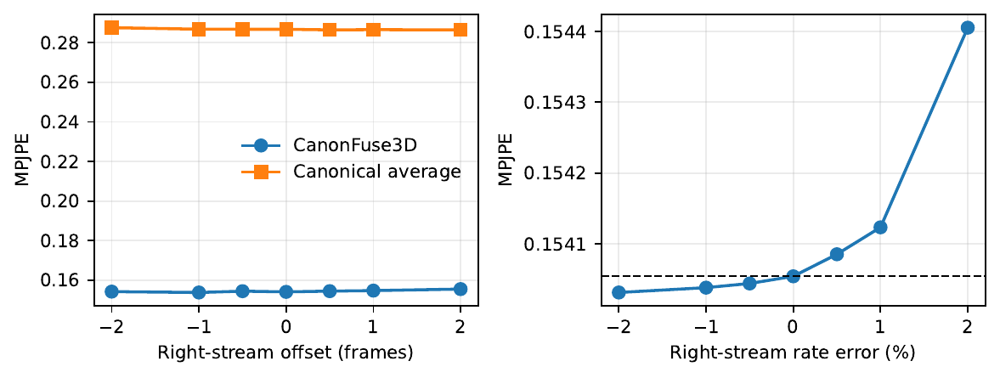
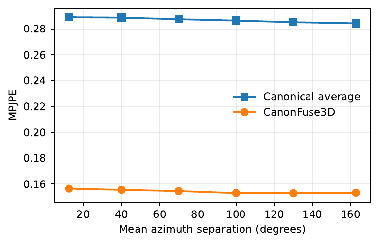
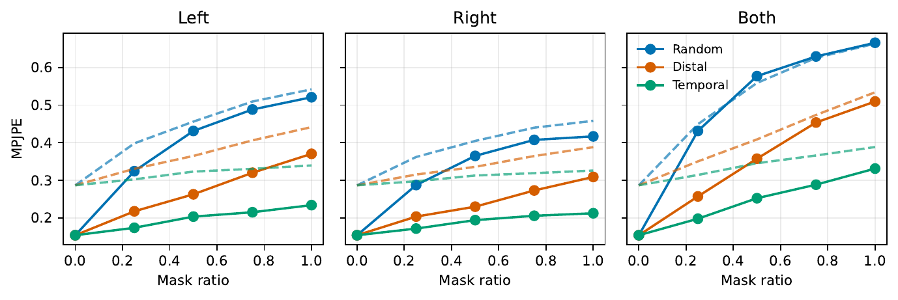
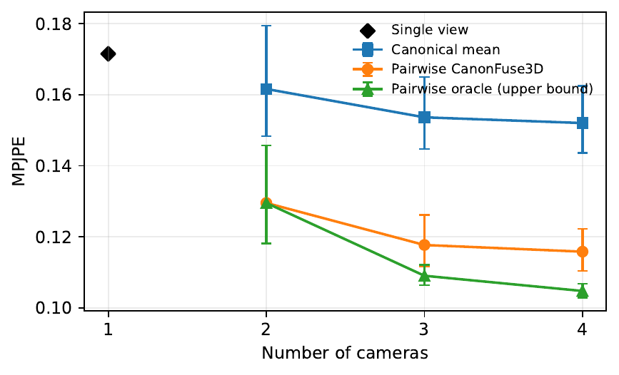
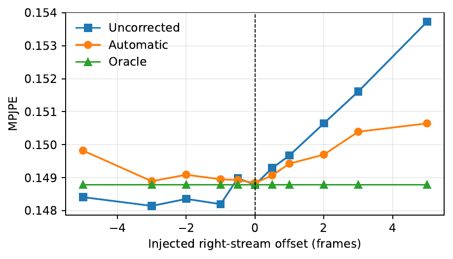
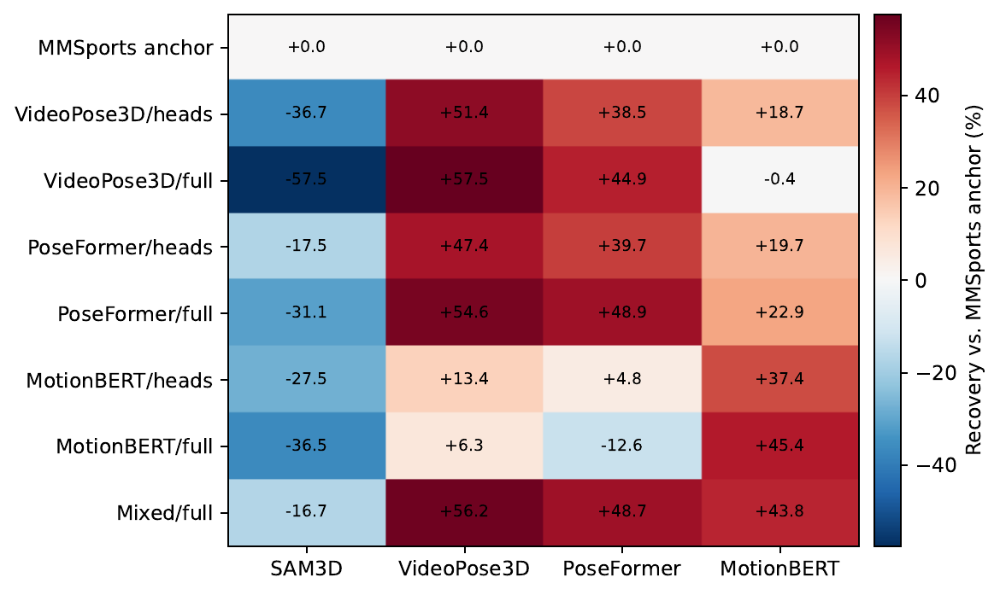

# 汇报摘要

本报告总结 CanonFuse3D 在 MMSports conference 工作基础上为 IVC 期刊稿追加的实验。原 MMSports 工作的科学中心保持不变：CanonFuse3D 在不使用相机内外参、图像或二维关键点作为融合网络输入的条件下，对两个单目三维姿态序列进行身体中心规范化、序列级相似变换对齐、双向跨视角注意力、短时序建模、可靠性门控融合和残差修正。期刊扩展的目标不是重新定义方法，而是回答原稿尚未充分覆盖的部署问题：模型对上游前端是否泛化、对轻微不同步是否稳定、相机夹角如何影响结果、缺失数据下何时失效、双视角模型能否组合到更多视角，以及遇到明显前端分布偏移后能否通过适配恢复。

目前共完成 **8 组扩展实验**：6 组冻结 Unity 参考检查点的评估、1 组自动时间对齐诊断，以及 1 组前端适配实验。除前端适配需要重新训练外，其余扩展实验均保持核心 CanonFuse3D 权重冻结。另已完成固定 Ski-PTZ-Pose 测试索引的独立重评估，用于建立 journal 的真实数据定量基准；它是基准审计，不计入 8 组扩展实验。自动时间对齐揭示了方向不对称和误触发问题，因此不用于强化论文主结论。

最重要的综合结论是：

> **CanonFuse3D 是一个在训练前端分布附近具有较强鲁棒性的无标定姿态空间精炼器，但不是与上游估计器无关的通用融合器。**

具体而言，原生 SAM3D 输入在完整 Unity 留出测试集上将 common-13 MPJPE 从 0.2792 降至 0.1551，改善 44.5%；在固定 30 条目的 Ski-PTZ-Pose common-13 测试索引上，将融合参考 MPJPE 从 0.3487 降至 0.1794，改善 48.6%。两帧以内的时间偏移和 2% 以内的采样率误差只造成不到 1% 的 MPJPE 变化；不同相机夹角区间均维持约 46% 的相对优势；单侧或结构化缺失时仍能利用互补视角。冻结双视角模型还可通过全部唯一相机对组合扩展到三至四视角，但当前串行融合延迟从双视角的 2.02 ms 增至 6.02/12.06 ms，而相对双视角的额外误差改善为 9.1%/10.6%，因此双视角是更合理的默认精度—成本折中。但冻结模型迁移到 PoseFormer 和 VideoPose3D 时出现负迁移，且两侧同时遭受高密度独立随机损坏时，学习融合不再优于规范化平均。前端适配可以显著修复分布偏移，但会产生原生前端保持能力与新前端性能之间的权衡。

## 一页结论

| 编号 | 扩展实验 | 完成状态 | 最关键结果 | 对论文的作用 |
|---|---|---:|---|---|
| J0 | Journal 定量基准审计 | 已完成 | Unity common-13：0.2792→0.1551；Ski-PTZ common-13：0.3487→0.1794 | 用当前、可追溯结果替代旧 conference 数表 |
| E1 | 前端泛化比较 | 已完成 | SAM3D +44.5%，MotionBERT +8.0%；PoseFormer -18.0%，VideoPose3D -12.8% | 划定“非前端无关”的部署边界 |
| E2 | 时间偏移鲁棒性 | 已完成 | ±2 帧内 MPJPE 变化不超过 +0.91% | 支撑轻微同步误差下的稳定性 |
| E3 | 采样率失配 | 已完成 | ±2% 内最坏 MPJPE 变化为 +0.23% | 支撑小幅时钟漂移容忍度 |
| E4 | 相机夹角分析 | 已完成 | 六个角度区间的融合增益为 45.9%–46.6% | 说明测试范围内无明显角度失效区 |
| E5 | 扩展遮挡/缺失鲁棒性 | 已完成 | 单侧、远端和时段缺失仍有明显优势；双侧随机损坏出现 -3.3% | 给出明确失效条件，而非只报告正结果 |
| E6 | N-view 扩展 | 已完成 | 1/2/3/4 视角 MPJPE 为 0.1715/0.1295/0.1177/0.1158；2/3/4 视角串行延迟为 2.02/6.02/12.06 ms | 双视角取得主要精度收益，更多视角收益递减且 pair 成本增长 |
| E7 | 自动时间对齐 | 已完成，诊断性 | +5 帧由 0.1537 改善到 0.1506；负整数偏移全部恶化 | 证明当前对齐器不是可靠的双向同步模块 |
| E8 | 前端适配训练 | 已完成 | 三种目标前端匹配误差分别恢复 57.5%、48.9%、45.4% | 说明负迁移可修复，但存在原生性能代价 |

# 1. 汇报范围与 journal 定量基准

## 1.1 与 MMSports 初版的关系

MMSports 论文是 CanonFuse3D 的已接收初版，介绍了模型结构、最初的双数据集比较、特征消融、初步 masking 分析和定性示例。IVC 稿保持模型结构不变，但扩展了完整测试集审计、前端迁移与适配、时序和相机条件扰动、系统性缺失输入、N-view 成对组合以及自动同步诊断。

为避免把不同来源的数字混在一起，当前 IVC 正文和本报告不再复制初版的数值表或特征消融数表。会议论文仍被引用并披露复用关系，但当前所有定量结论都来自 journal 证据目录中的评估记录。定性示例若源自初版，则继续明确标注来源。

## 1.2 当前 journal 定量基准

| 数据集 / 关节集 | 规范化平均 | CanonFuse3D | 相对改善 | 参考与协议 |
|---|---:|---:|---:|---|
| Unity / common-13 | 0.2792 | **0.1551** | 44.5% | 完整 64,440 相机对留出测试集；avatar 3D 骨架 |
| Unity / all-15 | 0.2868 | **0.1541** | 46.3% | 同一完整测试集；用于受控扰动实验 |
| Ski-PTZ-Pose / common-13 | 0.3487 | **0.1794** | 48.6% | 固定 30 条目测试索引；融合规范化参考 |

Ski-PTZ-Pose 的 acceleration error 同时从规范化平均的 0.0392 降至 0.0311。它衡量与融合规范化参考的一致性，不能解释为独立运动捕捉真值上的物理三维精度。此次独立重跑得到与初版记录相同的四位小数，但本报告使用的是新生成的固定索引结果文件，而不是复制会议表格。

Ski-PTZ-Pose 结果的来源控制如下：

- 数据集专用检查点：last.ckpt，epoch 97，SHA-256 为 2b985d4f8b5e1f083fa549ae1cfa524c7d48a8fa2452fbcb136f2f514d1ed78d。
- 固定索引 SHA-256：967a17ad2edfa8f56801d9a7cdd9c683dc73d0072660298ff65294445b41ba02。
- 测试协议：30 个 camera-pair 条目、每条 30 帧、common-13、batch size 4、drop_last=False、seed 42。
- 索引包含 150 train、0 validation、30 test。历史训练路径用 train 列表做 epoch 监控，因此这些监控值不是独立 validation 证据；为避免测试后选模，本次预先固定 epoch-97 last.ckpt 并只报告完整 test 结果。
- 索引中的历史绝对根目录仅在内存中重写，原 JSON 未修改。

## 1.3 本轮不包含的内容

当前论文和本报告均不使用多随机种子或多折交叉验证结果。Unity 扩展沿用固定 action-disjoint 划分和 seed 42，并通过完整测试集、检查点哈希、前端权重哈希、样本计数和无测试集适配来增强可复现性。Ski-PTZ-Pose 使用上述固定索引和独立检查点。本报告不把多种子/多折描述为“待完成实验”，以免造成论文承诺与实际证据不一致。

# 2. 扩展实验的统一设置

## 2.1 数据集与划分

扩展实验主要在 Unity synthetic 数据集上完成。Unity 数据包含两个 avatar，每个 avatar 执行 12 个动作片段，共 24 个 avatar-action 序列，覆盖稳定滑行、循环动作、摔倒和动作状态转换。每个动作从 180 个同步视角渲染：5 个相机高度层，每层 36 个方位角，相邻方位相差 10°。

动作级互斥划分如下：

| 划分 | avatar-action 数 | 相机对样本数 | 用途 |
|---|---:|---:|---|
| Train | 12 | 193,320 | 原模型训练或前端适配训练 |
| Validation | 8 | 128,880 | 检查点选择与自动对齐阈值校准 |
| Test | 4 | **64,440** | 所有扩展结果的最终评估 |

每个索引样本把共同帧均匀重采样为 30 帧序列；这些条目不是滑动窗口。扩展实验保留完整最后一个测试 batch，不以 `drop_last` 丢弃样本。

## 2.2 Ski-PTZ-Pose 定量协议

Ski-PTZ-Pose 仅用于数据集专用模型的真实数据定量评价，不参与 Unity 的扰动、前端适配或 N-view 实验。其 22 关节标注与过滤后的 SAM3D 输出映射到共同的 13 关节；两个同步视角的标注分别规范化后取平均，形成仅用于训练监督和指标计算的融合参考。模型不读取 PTZ 相机参数。由于该参考不是独立的物理 3D 真值，报告始终使用“融合参考一致性”表述。

## 2.3 固定模型与可复现性

- Unity journal 参考检查点 SHA-256：`869a2217f8676c0ada75ed3c9a3c82a9b8efbb105749f6ffb8bef71e9172f50f`。
- 检查点来自 epoch 89；模型隐藏维度 128、4 个 attention heads、dropout 0.1、时序卷积核 5。
- 原训练使用 AdamW，学习率 1e-3、weight decay 0.01、batch size 4096、100 epoch cosine schedule。
- 扰动随机数使用 seed 42。
- 时间、采样率、角度和 masking 实验使用全部 15 个 CanonFuse3D 关节。
- 跨前端比较与适配使用四种前端共同支持的 13 关节子集，即输出索引 2–14。

## 2.4 指标解释

主要指标为 MPJPE，即所有帧和关节上预测与参考三维点的平均欧氏距离；越低越好。Acceleration error 比较预测与参考的二阶时间差分，用于衡量运动稳定性。所有扩展数值均处于规范化数据集坐标中，不能改写成毫米。Gate preference accuracy 表示门控是否给真实误差较小的视角分配了更高权重；它是可靠性诊断，不是经过校准的概率或不确定度。

## 2.5 实验分层

- **冻结检查点实验（E1–E6）**：不改变核心模型参数，用于测量现有模型的外推范围和鲁棒性。
- **前置诊断模块（E7）**：在冻结模型之前增加时间对齐，不改变 CanonFuse3D 权重。
- **适配训练（E8）**：只使用 train/validation 数据训练新检查点，并在固定 test split 上统一评估。

# 3. E1：不同三维姿态前端的泛化比较

## 3.1 研究问题

Unity 参考模型由 SAM3D 产生的三维姿态流训练。如果替换上游三维姿态估计器，身体中心规范化是否足以消除前端之间的分布差异，从而让同一个融合检查点直接复用？

## 3.2 实验设计

比较四种前端：原生 SAM3D、VideoPose3D、PoseFormer 和 MotionBERT。后三种方法接收相同的 Unity ground-truth H36M-17 二维轨迹，以便只隔离“2D-to-3D lifting”环节，而不把二维检测器噪声混入比较。各前端输出统一映射到 common-13 骨架后，使用相同冻结 CanonFuse3D 检查点在全部 64,440 个测试相机对上评估。

## 3.3 结果

| 前端 | 规范化平均 MPJPE | 融合 MPJPE | 相对增益 | Gate preference |
|---|---:|---:|---:|---:|
| SAM3D（原生） | 0.2792 | **0.1551** | **+44.5%** | 91.7% |
| MotionBERT | 0.4766 | **0.4385** | +8.0% | 61.4% |
| PoseFormer | **0.4542** | 0.5360 | **-18.0%** | 52.3% |
| VideoPose3D | **0.4776** | 0.5389 | **-12.8%** | 47.0% |

## 3.4 结果解释

原生 SAM3D 上的 44.5% 改善和 91.7% gate preference 表明，门控确实学到了与训练分布一致的局部可靠性模式。MotionBERT 仍保留 8.0% 的正增益，但幅度明显收窄。PoseFormer 和 VideoPose3D 则出现负迁移，融合结果分别比各自的规范化平均差 18.0% 和 12.8%；二者的 gate preference 也接近或低于随机二选一水平。

这说明规范化可以减弱全局平移、旋转和尺度差异，但不能消除不同估计器的肢体偏差、时间统计、深度误差形态和骨架映射残差。当前检查点不能被称为 estimator-agnostic。

> **汇报结论：** 冻结 CanonFuse3D 对 MotionBERT 有有限的零样本迁移能力，但对 PoseFormer 和 VideoPose3D 不可靠。更换前端时必须重新验证，必要时进行适配训练。

## 3.5 局限性

该实验使用真实三维 lifting 模型，但二维输入是 Unity ground-truth tracks，目的是控制变量。它尚未覆盖图像检测误差、遮挡导致的二维关键点缺失和不同检测器之间的置信度偏差。因此结果严格支持“lifting 前端迁移”结论，而不是完整 RGB-to-3D pipeline 的端到端泛化结论。

# 4. E2：时间偏移鲁棒性

## 4.1 研究问题

双视角模型假设输入已同步，但实际相机可能存在不足一帧到数帧的触发误差。需要检验冻结模型在小范围时间错位下是否立即失效。

## 4.2 实验设计

保持左视角不变，对右视角注入 -2、-1、-0.5、0、+0.5、+1、+2 帧偏移。半帧条件通过线性插值产生，边界使用复制填充。每个条件均评估全部 64,440 个测试样本和全部 15 个关节。

## 4.3 结果

| 右流偏移 | 规范化平均 | 融合 MPJPE | 相对零偏移变化 | Gate corr. | Gate preference |
|---:|---:|---:|---:|---:|---:|
| -2 帧 | 0.2876 | 0.1542 | +0.08% | 0.646 | 91.5% |
| -1 帧 | 0.2869 | **0.1537** | -0.21% | 0.649 | 91.6% |
| -0.5 帧 | 0.2868 | 0.1544 | +0.22% | 0.648 | 91.6% |
| 0 帧 | 0.2868 | 0.1541 | 0.00% | 0.650 | 91.7% |
| +0.5 帧 | 0.2865 | 0.1544 | +0.24% | 0.650 | 91.7% |
| +1 帧 | 0.2866 | 0.1547 | +0.41% | 0.650 | 91.8% |
| +2 帧 | 0.2865 | 0.1555 | **+0.91%** | 0.649 | 91.8% |

## 4.4 结果解释

在 ±2 帧范围内，最坏 MPJPE 变化只有 +0.91%，且 gate correlation 保持在 0.646–0.650、gate preference 保持在 91.5% 以上。结果支持模型对小范围同步误差具有容忍度。-1 帧条件略优于零偏移不应解释为故意错位有益，它更可能来自插值、边界复制、有限动作组成和规范化后的轻微数值差异；整体趋势才是有效证据。

> **汇报结论：** 现有模型并不需要亚帧级完美同步才能保持结果，但该实验只覆盖 ±2 帧，不能推广到长时间延迟、掉帧或动作阶段完全错位。

# 5. E3：采样率失配鲁棒性

## 5.1 研究问题

即使两个视频在序列中心对齐，独立时钟也可能造成轻微帧率偏差，且误差会逐渐向序列两端累积。模型是否能容忍小幅采样率漂移？

## 5.2 实验设计

以序列中心帧为锚点，对右流施加 -2%、-1%、-0.5%、0、+0.5%、+1%、+2% 的局部采样率误差，并使用插值获得新的时间位置。其余设置与 E2 一致。

## 5.3 结果

| 采样率误差 | 规范化平均 | 融合 MPJPE | 相对零误差变化 | Gate preference |
|---:|---:|---:|---:|---:|
| -2% | 0.2868 | 0.1540 | -0.01% | 91.7% |
| -1% | 0.2868 | 0.1540 | -0.01% | 91.7% |
| -0.5% | 0.2868 | 0.1540 | -0.01% | 91.7% |
| 0 | 0.2868 | 0.1541 | 0.00% | 91.7% |
| +0.5% | 0.2868 | 0.1541 | +0.02% | 91.7% |
| +1% | 0.2867 | 0.1541 | +0.04% | 91.7% |
| +2% | 0.2865 | 0.1544 | **+0.23%** | 91.7% |

## 5.4 结果解释

±2% 内 MPJPE 几乎不变，最坏相对退化为 +0.23%。Acceleration error 随速率误差并不单调，因为时间重采样既会引入错位，也可能平滑局部轨迹，所以本实验以 MPJPE 作为更清晰的敏感性指标。

> **汇报结论：** 在 30 帧短序列、中心锚定和 ±2% 的受控范围内，CanonFuse3D 对小幅时钟漂移不敏感；这不等同于对长序列累计漂移或动态可变帧率具有鲁棒性。

# 6. E4：相机夹角分析

## 6.1 研究问题

多视角方法通常受视角几何影响。过小夹角可能缺少互补深度信息，过大夹角则可能带来更大的外观和遮挡差异。需要确定无标定姿态空间融合是否存在明显的相机夹角失效区间。

## 6.2 实验设计

依据两个 Unity 相机的圆周方位角差，将全部测试相机对划分为六个互斥的 30° 区间。各区间样本合计恰好为 64,440，不进行有利子集筛选。

## 6.3 结果

| 相机夹角 | 样本数 | 规范化平均 | 融合 MPJPE | 相对增益 |
|---:|---:|---:|---:|---:|
| 0–30° | 8,640 | 0.2891 | 0.1563 | 45.9% |
| 30–60° | 10,800 | 0.2888 | 0.1554 | 46.2% |
| 60–90° | 10,800 | 0.2876 | 0.1544 | 46.3% |
| 90–120° | 10,800 | 0.2865 | 0.1529 | **46.6%** |
| 120–150° | 10,800 | 0.2852 | **0.1528** | 46.4% |
| 150–180° | 12,600 | 0.2844 | 0.1532 | 46.1% |

## 6.4 结果解释

融合 MPJPE 从最小夹角区间的 0.1563 缓慢下降到 120–150° 的 0.1528，并在 150–180° 略回升到 0.1532。所有区间相对规范化平均的增益均在 45.9%–46.6% 之间，未观察到尖锐的角度失效点。较大方位差在该合成设置中提供了略多互补信息，但变化幅度很小，不足以宣称存在最佳安装角度。

> **汇报结论：** 在 Unity 的相机高度和方位分布内，CanonFuse3D 对相机方位差较稳定；结果支持“无明显角度失效区”，但不支持“120–150° 是最优相机布局”的强结论。

# 7. E5：扩展遮挡与缺失鲁棒性

## 7.1 研究问题

原 conference 已包含 masking 趋势图，但需要更系统地回答两个问题：当只有一个视角损坏时，另一视角能否提供补偿；当两侧同时损坏、跨视角冗余消失时，学习融合在哪种模式下失效？

## 7.2 实验设计

实验为 3 个受影响视角模式（left、right、both）× 3 个损坏模式（random、distal、temporal）× 5 个比例（0、0.25、0.5、0.75、1.0），共 **45 个测试单元**。

- Random：对关节-帧位置进行独立随机损坏。
- Distal：只在双腕、双肘、双膝和双踝共 8 个远端关节上按比例损坏。
- Temporal：按比例选择关节，并对每个选中关节损坏一个独立定位的连续 10 帧区间；这里的 ratio 是“被选择关节的比例”，不是整个张量的损坏比例。
- 损坏值由 35% 置零和 65% 高斯扰动组成，高斯标准差为规范化坐标中的 0.08。
- Both 条件的两侧 mask 和噪声独立采样，因此是更困难的双侧无结构损坏。

## 7.3 代表性结果

下表列出 ratio 0.5 和 1.0 的全部组合；ratio 0、0.25 和 0.75 也已执行并保存在证据 CSV 中。

| 受影响视角 | 模式 | Ratio | 规范化平均 | 融合 MPJPE | 相对增益 |
|---|---|---:|---:|---:|---:|
| Left | Random | 0.50 | 0.4561 | 0.4312 | +5.5% |
| Left | Random | 1.00 | 0.5420 | 0.5209 | +3.9% |
| Left | Distal | 0.50 | 0.3649 | 0.2629 | +28.0% |
| Left | Distal | 1.00 | 0.4415 | 0.3704 | +16.1% |
| Left | Temporal | 0.50 | 0.3232 | 0.2036 | +37.0% |
| Left | Temporal | 1.00 | 0.3397 | 0.2341 | +31.1% |
| Right | Random | 0.50 | 0.4047 | 0.3650 | +9.8% |
| Right | Random | 1.00 | 0.4582 | 0.4169 | +9.0% |
| Right | Distal | 0.50 | 0.3359 | 0.2300 | +31.5% |
| Right | Distal | 1.00 | 0.3882 | 0.3090 | +20.4% |
| Right | Temporal | 0.50 | 0.3128 | 0.1942 | +37.9% |
| Right | Temporal | 1.00 | 0.3260 | 0.2125 | +34.8% |
| Both | Random | 0.50 | **0.5589** | 0.5771 | **-3.3%** |
| Both | Random | 1.00 | **0.6634** | 0.6658 | **-0.4%** |
| Both | Distal | 0.50 | 0.4088 | 0.3575 | +12.5% |
| Both | Distal | 1.00 | 0.5341 | 0.5096 | +4.6% |
| Both | Temporal | 0.50 | 0.3454 | 0.2525 | +26.9% |
| Both | Temporal | 1.00 | 0.3886 | 0.3313 | +14.7% |

## 7.4 结果解释

单侧损坏时，模型通常可以借助未损坏的互补视角，尤其对有结构的远端关节缺失和连续时段缺失：ratio 0.5 时分别保留约 28.0%–31.5% 和 37.0%–37.9% 的优势。Random 损坏破坏位置分散，优势明显缩小。

双侧 temporal 和 distal 损坏仍保留正增益，说明模型并非只能在一侧完全干净时工作，也能利用损坏之外的结构信息。但双侧独立 random 损坏在 ratio 0.5 和 1.0 时分别出现 -3.3% 和 -0.4% 的负增益。这是当前模型最清晰的输入损坏失效区：当两侧在大量不同位置同时提供错误证据时，门控和残差修正可能放大错误，而简单平均反而更稳健。

> **汇报结论：** CanonFuse3D 对“一个视角较差”以及“结构化缺失”具有明显价值；对两侧同时发生的高密度独立随机错误不可靠。部署系统应在双流整体质量同时下降时提供退化检测或回退到简单平均。

## 7.5 局限性

遮挡由人工噪声模型模拟，不能完全替代真实检测器在雪雾、运动模糊、器材遮挡和人体自遮挡下产生的相关错误。后续端到端研究应使用真实二维/三维前端失败案例复现该边界。

# 8. E6：N-view 扩展

## 8.1 研究问题

CanonFuse3D 原生只接收两个视角。若部署环境拥有 3–4 台相机，是否必须重构模型，还是可以复用冻结双视角网络，通过所有相机对的输出组合获得额外收益？

## 8.2 实验设计

从完整的 36 相机动作环中循环去重提出 180 个候选四相机组。严格要求同组四台相机至少具有 30 个共同帧，并保留接受/拒绝记录；最终有 44 个相机组通过。对于同一组，构造嵌套的 N=1、2、3、4 输入。

当 N≥2 时，对所有唯一相机对运行冻结 CanonFuse3D，再平均所有成对输出，得到可部署的 pairwise composition。作为参照，报告所有输入的规范化平均；另外从完整相机对中事后选择最佳 pair 作为 oracle 上界。Oracle 使用测试误差选择，不能部署。

为排除 CUDA 冷启动，计时前先执行 10 次完整四视角组合预热。随后在同一块 NVIDIA RTX A6000 上，对 44 个通过筛选的 30 帧相机组分别测量 N=2、3、4。每个计时区间前后进行 CUDA 同步；当前实现串行执行所有唯一 pair。计时包含逐 pair 规范化、CanonFuse3D 前向和最终算术平均，不包含单目三维姿态前端、数据加载和 oracle 选择。

## 8.3 结果

| 视角数 | 方法 | 相机组 | MPJPE | SD | 95% bootstrap CI |
|---:|---|---:|---:|---:|---|
| 1 | 单视角 | 44 | 0.1715 | 0.0731 | [0.1560, 0.1965] |
| 2 | 规范化平均 | 44 | 0.1616 | 0.0538 | [0.1484, 0.1795] |
| 2 | Pairwise CanonFuse3D | 44 | **0.1295** | 0.0478 | [0.1181, 0.1457] |
| 3 | 规范化平均 | 44 | 0.1536 | 0.0352 | [0.1447, 0.1649] |
| 3 | Pairwise CanonFuse3D | 44 | **0.1177** | 0.0254 | [0.1116, 0.1261] |
| 3 | Pairwise oracle | 44 | 0.1090 | 0.0100 | [0.1063, 0.1121] |
| 4 | 规范化平均 | 44 | 0.1520 | 0.0321 | [0.1436, 0.1625] |
| 4 | Pairwise CanonFuse3D | 44 | **0.1158** | 0.0209 | [0.1104, 0.1223] |
| 4 | Pairwise oracle | 44 | 0.1047 | 0.0066 | [0.1029, 0.1067] |

**精度—推理成本：**

| 视角数 | 唯一 pair 数 | Pairwise MPJPE | 相对双视角误差降低 | 串行延迟（ms/30帧组） | 相对延迟 | 组/秒 | 峰值分配显存（MiB） |
|---:|---:|---:|---:|---:|---:|---:|---:|
| 2 | 1 | 0.1295 | — | 2.02 | 1.00× | 494.7 | 12.28 |
| 3 | 3 | 0.1177 | 9.1% | 6.02 | 2.98× | 166.1 | 12.31 |
| 4 | 6 | 0.1158 | 10.6% | 12.06 | 5.96× | 83.0 | 12.33 |

以上延迟为 44 个相机组的同步均值；前端推理和磁盘 I/O 不在计时范围内。该结果反映当前串行 pairwise composition 实现，若对独立 pair 进行 batch 或并行调度，实际 wall-clock 延迟可能降低，但 pair 数仍按 N(N−1)/2 增长。

## 8.4 结果解释

从单视角 0.1715 到双视角 pairwise fusion 0.1295，误差降低 24.5%，且双视角只需要一次 pair forward，串行融合延迟为 2.02 ms。增加到三视角后，MPJPE 相对双视角进一步改善 9.1%，但需要 3 个 pair，延迟升至 6.02 ms（2.98 倍）。四视角相对双视角总共改善 10.6%，需要 6 个 pair，延迟为 12.06 ms（5.96 倍）；从三视角到四视角的额外精度改善仅为 1.6%。因此更多视角总体有益，但边际收益明显递减，而当前串行计算成本接近随 pair 数增长。双视角已经取得从单视角到多视角的主要精度收益，是本文主配置中更合理的精度—成本折中；三至四视角适合精度优先且能够接受额外计算成本的场景。四视角结果仍高于 oracle 0.1047，说明更好的相机对可靠性选择仍有潜力。

报告的置信区间是相机组 bootstrap 的均值区间，不等同于所有方法之间差异均已通过成对显著性检验。因此这里报告趋势与效果量，不额外声称统计显著。

> **汇报结论：** 不修改网络即可把双视角模型组合到 3–4 视角，并继续获得收益；但双视角已取得主要精度收益。当前串行实现从双视角扩展到三/四视角时，延迟由 2.02 ms 增至 6.02/12.06 ms，而额外误差改善为 9.1%/10.6%，因此双视角是本文默认的精度—成本折中。

# 9. E7：自动时间对齐

## 9.1 研究问题

E2 表明轻微错位不会立即破坏结果，但更大未知偏移仍需处理。实验检验一个放在冻结 CanonFuse3D 之前的自动时间校正模块，能否从姿态运动本身估计右流延迟并恢复正确对齐。

## 9.2 修正后的严格协议

该实验针对早期实现中的评估问题进行了局部修正：

1. 每个样本、每个视角都使用自身第一帧建立身体中心坐标，不允许 batch 中一个样本定义另一个样本的变换。
2. 在 -5 到 +5 帧之间以半帧步长搜索右流校正量。
3. 置信度阈值只根据 validation split 的 offset MAE 选择，最终固定为 **0.09296**，测试结果不参与阈值调整。
4. 在 test split 注入 -5、-3、-2、-1、-0.5、0、+0.5、+1、+2、+3、+5 共 11 个偏移。
5. Uncorrected、Automatic 和 Oracle 三个条件都只评价相同的中心 20 帧，序列两侧各留 5 帧余量，避免偏移改变被评价的动作内容。
6. Oracle 恢复未扰动右流，仅作为性能上界。Exact accuracy 定义为绝对 lag 误差小于 0.25 帧；辅助 ±0.5 帧指标使用严格小于 0.5 帧。
7. 共完成 11×3=**33 个测试单元**，并加入 batch-order invariance 回归测试。

## 9.3 计算公式

设左、右三维姿态序列为

$$
\mathbf{P}^{L},\mathbf{P}^{R}\in\mathbb{R}^{T\times J\times 3},
$$

其中本实验中 $T=30$、$J=15$。对右流注入时间偏移 $\delta$：

$$
\tilde{\mathbf{P}}^{R}_{\delta}(t)=\mathbf{P}^{R}(t-\delta),
$$

其中 $\delta\in\{-5,-3,-2,-1,-0.5,0,0.5,1,2,3,5\}$，半帧位置由线性插值得到。理想校正量为

$$
c^{*}=-\delta.
$$

自动模块在半帧网格上搜索候选校正量：

$$
c\in\{-5,-4.5,-4,\ldots,4.5,5\},
$$

并对注入偏移后的右流施加候选校正：

$$
\hat{\mathbf{P}}^{R}_{\delta,c}(t)=\tilde{\mathbf{P}}^{R}_{\delta}(t-c).
$$

左右流分别使用各自样本第一帧建立身体中心坐标系：

$$
\bar{\mathbf{P}}^{L}=\mathcal{C}(\mathbf{P}^{L}),\qquad
\bar{\mathbf{P}}^{R}_{\delta,c}=\mathcal{C}(\hat{\mathbf{P}}^{R}_{\delta,c}).
$$

这里 $\mathcal{C}(\cdot)$ 表示以 pelvis 为中心、由髋部和颈部关节定义身体方向轴的 canonicalization。随后计算一阶速度并去除每帧的全关节平均速度：

$$
\mathbf{V}(t,j)=\bar{\mathbf{P}}(t+1,j)-\bar{\mathbf{P}}(t,j),
$$

$$
\mathbf{D}(t,j)=\mathbf{V}(t,j)-\frac{1}{J}\sum_{k=1}^{J}\mathbf{V}(t,k).
$$

对每个候选校正量 $c$，只使用 shift 后仍有效的时间 transition，将左右描述子拉平并计算余弦相似度：

$$
s(c)=
\frac{\langle \mathbf{D}^{L},\mathbf{D}^{R}_{\delta,c}\rangle}
{\|\mathbf{D}^{L}\|_{2}\,\|\mathbf{D}^{R}_{\delta,c}\|_{2}}.
$$

最佳候选和零校正得分分别为

$$
c_{\mathrm{best}}=\arg\max_{c}s(c),\qquad s_{0}=s(0).
$$

置信度定义为最佳得分相对零校正的增量：

$$
q=s(c_{\mathrm{best}})-s_{0}.
$$

阈值 $\tau$ 只在 validation split 上按 offset MAE 选择，本实验固定为 $\tau=0.09295667856931687$。最终自动校正量为

$$
\hat{c}=
\begin{cases}
c_{\mathrm{best}}, & q>\tau,\\
0, & q\le\tau.
\end{cases}
$$

三种评价条件对应的冻结 CanonFuse3D 输入为

$$
\mathbf{Y}_{\mathrm{uncorr}}=F(\mathbf{P}^{L},\tilde{\mathbf{P}}^{R}_{\delta}),
$$

$$
\mathbf{Y}_{\mathrm{auto}}=F(\mathbf{P}^{L},\tilde{\mathbf{P}}^{R}_{\delta,\hat{c}}),
$$

$$
\mathbf{Y}_{\mathrm{oracle}}=F(\mathbf{P}^{L},\mathbf{P}^{R}),
$$

其中 $F(\cdot)$ 为冻结的 CanonFuse3D，Oracle 恢复未扰动右流。所有 MPJPE 只在中心 20 帧 $\mathcal{T}_{m}=\{5,6,\ldots,24\}$ 上计算：

$$
\mathrm{MPJPE}=
\frac{1}{|\mathcal{T}_{m}|J}
\sum_{t\in\mathcal{T}_{m}}\sum_{j=1}^{J}
\left\|\mathbf{Y}(t,j)-\mathbf{G}(t,j)\right\|_{2},
$$

其中 $\mathbf{G}$ 为 canonicalized ground truth。Lag 估计误差、exact accuracy 和激活率定义为

$$
\mathrm{Lag\ MAE}=
\frac{1}{N}\sum_{i=1}^{N}\left|\hat{c}_{i}-c^{*}_{i}\right|,
$$

$$
\mathrm{Exact\ Acc}=
\frac{1}{N}\sum_{i=1}^{N}
\mathbb{I}\left(\left|\hat{c}_{i}-c^{*}_{i}\right|<0.25\right),
$$

$$
\mathrm{Active\ Rate}=
\frac{1}{N}\sum_{i=1}^{N}
\mathbb{I}\left(\hat{c}_{i}\ne 0\right).
$$

这些公式说明 E7 衡量的是“基于姿态速度的前置时间校正是否改善冻结融合结果”，而不是重新训练或修改 CanonFuse3D。

## 9.4 结果

| 注入偏移 | 未校正 | 自动校正 | Oracle | 自动变化 | Lag MAE | Exact | 激活率 |
|---:|---:|---:|---:|---:|---:|---:|---:|
| -5 | 0.1484 | 0.1498 | 0.1488 | +0.00141 | 2.550 | 15.8% | 75.3% |
| -3 | 0.1481 | 0.1489 | 0.1488 | +0.00075 | 2.093 | 7.0% | 61.0% |
| -2 | 0.1484 | 0.1491 | 0.1488 | +0.00073 | 1.788 | 7.1% | 71.3% |
| -1 | 0.1482 | 0.1489 | 0.1488 | +0.00075 | 1.682 | 8.0% | 71.9% |
| -0.5 | 0.1490 | 0.1489 | 0.1488 | -0.00005 | 1.205 | 1.8% | 34.2% |
| 0 | 0.1488 | 0.1488 | 0.1488 | +0.00005 | 0.965 | 58.5% | 41.5% |
| +0.5 | 0.1493 | 0.1491 | 0.1488 | -0.00022 | 1.170 | 1.8% | 32.1% |
| +1 | 0.1497 | 0.1494 | 0.1488 | -0.00025 | 1.686 | 8.0% | 70.7% |
| +2 | 0.1506 | 0.1497 | 0.1488 | -0.00095 | 1.813 | 7.0% | 71.0% |
| +3 | 0.1516 | 0.1504 | 0.1488 | -0.00122 | 2.191 | 6.2% | 58.0% |
| +5 | 0.1537 | **0.1506** | 0.1488 | **-0.00308** | 2.673 | 13.2% | 75.1% |

负的“自动变化”表示自动校正优于未校正输入。

## 9.5 结果解释

自动校正对所有正整数延迟均有改善，且延迟越大，绝对改善越明显：+5 帧时从 0.1537 降至 0.1506，约恢复了未校正到 oracle 差距的 63%。然而，所有负整数 lead 条件都恶化；-5 帧从 0.1484 升至 0.1498。零偏移时仍有 41.5% 样本激活非零校正，MPJPE 也从约 0.14879 略升至 0.14884。+5 帧的 exact lag accuracy 只有 13.2%，说明 MPJPE 改善并不代表偏移估计本身准确。

这一方向不对称表明当前基于规范化关节速度的描述子和阈值更像“延迟诊断器”，尚未构成可靠的双向同步方案。可能原因包括动作速度描述的时间方向歧义、边界/插值影响以及置信度不足以排除错误峰值。

> **汇报结论：** 自动模块对正向延迟有部分恢复能力，但不能声称解决未知双向时间同步。论文应把它作为限制分析和下一步方向，而不是主方法的新增组成模块。

# 10. E8：前端适配训练

## 10.1 研究问题

E1 暴露了冻结模型在 PoseFormer 和 VideoPose3D 上的负迁移。需要判断问题是方法原则上无法适配，还是仅由训练前端分布不匹配造成；同时还要检查适配新前端后是否遗忘原生 SAM3D。

## 10.2 实验设计

对 VideoPose3D、PoseFormer、MotionBERT 分别训练两种适配范围：

- **Heads-only**：只更新 gate 和 residual heads。
- **Full**：更新全部 CanonFuse3D 参数。

另外训练一个由 SAM3D 与三种替代前端平衡混合的 **Mixed/full** 模型。所有适配使用相同固定 Unity train/validation/test 划分；只在 train 和 validation action 上训练及选模，不接触 test。每个模型训练 20 epoch，学习率 1e-4，以 validation common-13 MPJPE 选择检查点。

冻结 Unity 参考模型 加 7 个适配模型，分别在 4 种前端上测试，形成完整 **8×4=32 个 test cells**。该矩阵既测目标前端恢复，也把 SAM3D 列作为 forgetting/retention 检查。

## 10.3 完整结果矩阵

| 适配模型 | SAM3D | VideoPose3D | PoseFormer | MotionBERT |
|---|---:|---:|---:|---:|
| Unity 参考模型 | **0.1551** | 0.5389 | 0.5360 | 0.4385 |
| VideoPose3D/heads | 0.2120 | 0.2621 | 0.3297 | 0.3567 |
| VideoPose3D/full | 0.2442 | **0.2290** | 0.2954 | 0.4403 |
| PoseFormer/heads | 0.1822 | 0.2833 | 0.3234 | 0.3521 |
| PoseFormer/full | 0.2033 | 0.2447 | **0.2741** | 0.3381 |
| MotionBERT/heads | 0.1976 | 0.4667 | 0.5100 | 0.2744 |
| MotionBERT/full | 0.2117 | 0.5050 | 0.6036 | **0.2393** |
| Mixed/full | 0.1809 | 0.2363 | 0.2751 | 0.2464 |

## 10.4 结果解释

目标前端上的 full adaptation 把 VideoPose3D 从 0.5389 降至 0.2290、PoseFormer 从 0.5360 降至 0.2741、MotionBERT 从 0.4385 降至 0.2393；相对各自 anchor 误差，分别恢复 57.5%、48.9% 和 45.4%。这说明 E1 的负迁移主要来自输入误差分布不匹配，而不是双视角融合在这些前端上原则上无效。

Heads-only 通常能以较小的原生性能代价获得明显恢复。例如 PoseFormer/heads 在 SAM3D 上为 0.1822，优于 PoseFormer/full 的 0.2033；但目标 PoseFormer 上的 0.3234 又不如 full adaptation 的 0.2741。也就是说，冻结 backbone 有利于保留原生能力，完全更新则更有利于目标前端拟合。

Mixed/full 在三个替代前端上分别达到 0.2363、0.2751 和 0.2464，是最均衡的单模型方案，但 SAM3D 从 0.1551 上升到 0.1809，相当于 16.7% 的原生误差增幅。因此不存在一个模型在所有四种输入上同时占优。

> **汇报结论：** 前端适配能有效修复冻结模型的分布偏移；如果部署前端固定，使用目标前端 full adaptation；如果系统需要动态接收不同前端，mixed/full 更均衡，但必须接受 SAM3D 性能下降。更理想的长期方案是显式前端条件化或多域训练。

# 11. 跨实验综合分析

## 11.1 哪些结论已经得到较强支持

1. **原生前端下的完整 Unity 测试集改进可靠。** 在 64,440 个测试相机对上，SAM3D common-13 从 0.2792 降至 0.1551，改善 44.5%。
2. **固定 Ski-PTZ-Pose 测试结果提供真实数据上的补充证据。** 在全部 30 个 common-13 测试条目上，融合参考 MPJPE 从 0.3487 降至 0.1794，改善 48.6%。
3. **短范围时序扰动不会立即破坏融合。** ±2 帧偏移的最坏退化为 0.91%，±2% 采样率误差的最坏退化为 0.23%。
4. **测试范围内的相机夹角影响很小。** 六个方位角区间均保持约 46% 的相对增益。
5. **互补视角对单侧和结构化缺失有效。** 远端关节与短时段缺失下的改善远高于无结构随机损坏。
6. **双视角模型可以不改结构地组合到更多视角，但双视角提供更合适的默认精度—成本折中。** N=3 和 N=4 的 pairwise composition 继续降低平均误差；相对双视角的额外改善为 9.1% 和 10.6%，而当前串行延迟由 2.02 ms 增至 6.02 ms 和 12.06 ms。
7. **前端分布偏移可以通过适配显著缓解。** 三种替代前端的目标性能均得到大幅恢复。

## 11.2 哪些结论只能有条件地表述

- “无标定”只表示融合模型不输入相机内参、外参、极线几何或图像观测；数据准备仍使用同步记录和数据集参考。
- 小偏移鲁棒性只适用于已测试的短序列和受控扰动范围，不能外推到长延迟、掉帧和动态帧率。
- N-view 结果来自冻结双视角模型的成对组合，不是端到端 N-view architecture；oracle 只能作为上界。
- 前端适配证明可恢复性，但不证明一个统一检查点能无代价支持所有前端。
- 当前固定索引的 Ski-PTZ-Pose 结果是融合参考一致性，不是独立物理三维真值精度；其索引没有非空 validation split，因此不作独立验证选模的主张。

## 11.3 当前证据明确不支持的说法

- 不支持“CanonFuse3D 对任意三维姿态前端都能零样本泛化”。
- 不支持“自动模块已解决双向未知时间同步”。
- 不支持“在两侧高密度随机错误下，学习融合始终优于简单平均”。
- 不支持把规范化坐标 MPJPE 写成毫米。
- 不支持声称所有扩展均已在真实 Ski-PTZ-Pose 上复现；新增系统性扩展主要在 Unity 上完成。
- 当前不提供多种子或多折稳定性结论。

## 11.4 最适合 IVC 论文的主叙事

期刊扩展不应只强调“增加了更多正结果”，而应呈现完整的能力边界：

> CanonFuse3D 在原生前端、轻微同步误差、广泛相机方位差以及单侧或结构化输入损坏下具有稳定的融合收益；通过冻结成对组合可扩展到更多视角，但双视角取得主要精度收益并提供更有利的精度—串行推理成本折中；通过前端适配可恢复新的 lifting 分布。与此同时，前端零样本迁移、双侧独立随机损坏和自动双向同步仍是当前限制。

这一表述同时包含正结果、负结果和可操作的部署建议，比“模型对所有条件均鲁棒”更符合现有证据。

# 12. 实验完成度与论文使用建议

## 12.1 完成度

| 类别 | 数量 | 状态 |
|---|---:|---|
| 当前 journal 定量基准 | Unity 完整留出集 + Ski-PTZ 固定 30 条目 | 已完成并带哈希归档 |
| 期刊冻结检查点扩展 | 6 组 | 全部完成 |
| P1 适配训练 | 1 组，7 次训练、32 个测试单元 | 全部完成 |
| 自动时间对齐 | 33 个测试单元 | 全部完成，但仅作诊断 |
| Masking | 45 个测试单元 | 全部完成 |
| 多种子/多折 | 0 | 已从当前论文范围删除 |

按论文组织方式，可将 E1–E5 表述为五项 journal-scale extension，将 E6–E8 表述为进一步的 P1 分析。总计 **8 项新增实验均已有结果**。

## 12.2 汇报时建议强调的六组数字

1. **44.5%**：原生 SAM3D 在完整 Unity 测试集上的 common-13 融合增益。
2. **48.6%**：固定 30 条目 Ski-PTZ-Pose 测试集上的 common-13 融合参考增益。
3. **<1%**：±2 帧和 ±2% 小扰动范围内的最坏 MPJPE 变化。
4. **45.9%–46.6%**：六个相机角度区间中稳定的融合增益范围。
5. **2.02 / 6.02 / 12.06 ms**：双、三、四视角成对组合的串行融合延迟；相对双视角的额外误差改善只有 9.1% / 10.6%。
6. **57.5% / 48.9% / 45.4%**：三种替代前端经 full adaptation 后相对冻结参考模型的匹配前端误差恢复。

同时必须配套报告两个负结果：PoseFormer/VideoPose3D 冻结迁移为 -18.0%/-12.8%，以及 both-view random masking ratio 0.5 时为 -3.3%。

# 13. 证据与产物索引

本报告数字直接来自当前 IVC 独立实验产物，主要证据如下：

- `../ivc_draft_20260821/evidence/evidence_manifest.md`：检查点、数据划分、样本数、前端权重与预测 manifest 的哈希记录。
- `../ivc_draft_20260821/tables/native_reference.tex`：Unity all-15 与 common-13 的当前主结果。
- `../ivc_draft_20260821/tables/ski_poseptz_reference.tex`：Ski-PTZ-Pose 固定 common-13 测试结果。
- `../ivc_draft_20260821/evidence/results/ski_poseptz_journal__journal_evaluation_last.json`：Ski-PTZ 指标、检查点哈希、索引哈希和运行协议。
- `../ivc_draft_20260821/tables/frontend_generalization.tex`：四前端冻结泛化结果。
- `../ivc_draft_20260821/tables/temporal_sampling.tex`：时间偏移与采样率代表性结果。
- `../ivc_draft_20260821/tables/view_angle.tex`：六个相机夹角区间结果。
- `../ivc_draft_20260821/tables/masking_summary.tex`：masking 代表性强度结果。
- `../ivc_draft_20260821/tables/nview_scaling.tex`：N=1–4、bootstrap CI 与 oracle 上界。
- `../ivc_draft_20260821/tables/nview_efficiency.tex`：N=2–4 的唯一 pair 数、串行延迟、吞吐量和峰值分配显存。
- `../ivc_draft_20260821/tables/temporal_alignment.tex`：11 个偏移下的未校正、自动和 oracle 结果。
- `../ivc_draft_20260821/tables/frontend_adaptation.tex`：8×4 前端适配完整矩阵。
- `../ivc_draft_20260821/evidence/results/*.csv`：冻结扩展实验的逐条件汇总文件。

## 最终结论

所有计划纳入当前 IVC 扩展叙事的实验已经形成可用结果。它们共同把论文从“一个双视角融合方法在两个数据集上有效”扩展为“一个经过完整留出集审计、具有明确时序/视角/缺失鲁棒性边界、可组合到更多视角、并能通过适配处理前端变化的姿态空间精炼框架”。N-view 实验进一步表明，更多视角可以继续降低误差，但当前串行 pairwise composition 的成本随唯一相机对数量增长；双视角以 2.02 ms 获得主要精度收益，是本文更合理的默认配置。实验也揭示了三个必须诚实保留的限制：冻结模型依赖训练前端分布、自动同步存在方向不对称、双侧高密度随机错误会破坏学习融合优势。

因此，当前最稳妥的论文结论不是“通用多视角三维重建”，而是：**CanonFuse3D 是一种不依赖相机标定、在合适输入条件下稳健、但对前端分布和输入质量有明确依赖的后估计双视角姿态精炼方法。**
